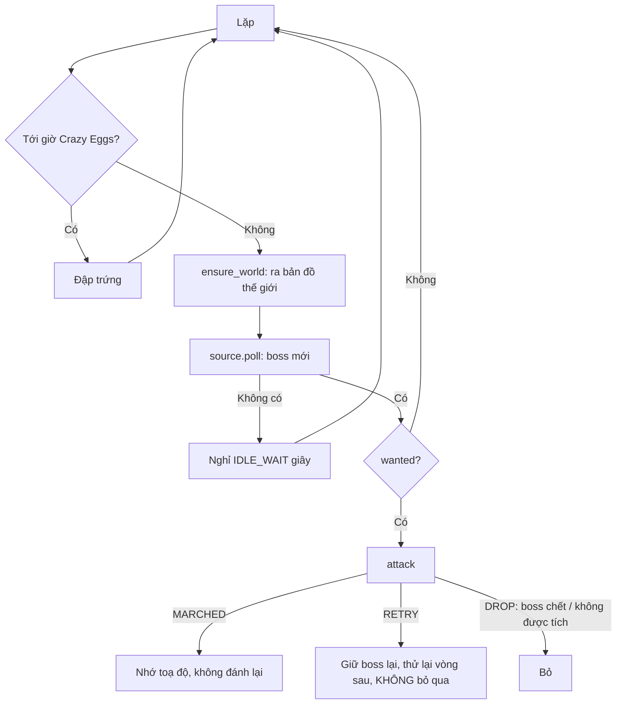
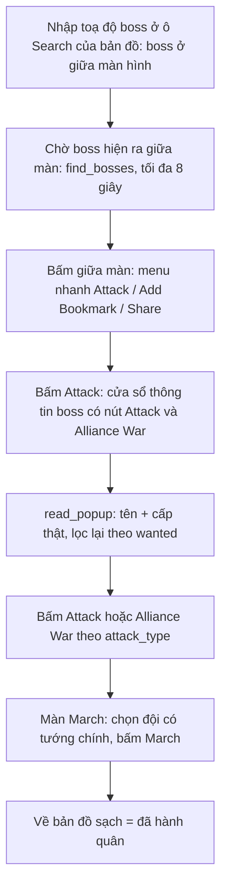
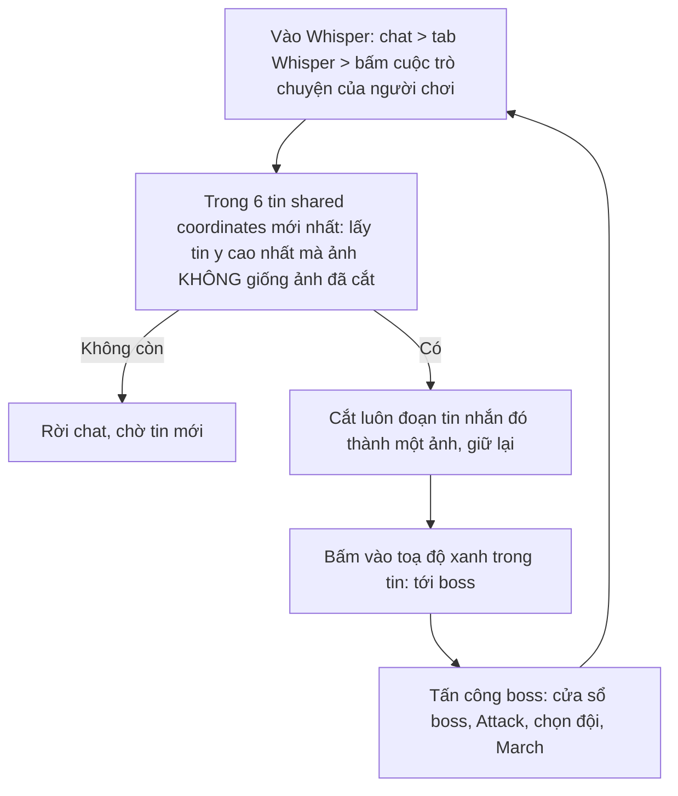

# Flow của Attack Boss

## Điểm vào
`run(bot, settings)` ([run.py](run.py)), chạy MỘT MÌNH (`EXCLUSIVE_ACTIVITIES`): worker gọi thẳng, không qua Bubble / Auto Times Out / Join Boss / nhiệm vụ khác. Hàm tự lặp tới khi Stop. Nút Select Activity "Attack Boss" là exclusive.

| Key (settings["Attack Boss"]) | Ý nghĩa |
| --- | --- |
| `source` | `alliance_chat` (mặc định) / `player_chat` (hiện trên tab là "Whisper") / `api`: chỉ dùng một |
| `player_name` | tên người chơi gửi boss (nguồn `player_chat`) |
| `attack_type` | `attack` (đánh một mình, mặc định) / `alliance_war` (lập rally); nguồn `player_chat` luôn dùng `attack` (có thể không có Alliance War), ô chọn bị khoá |
| `viking_summon`, `viking_level` | Viking tự gọi (Summon) + độ khó Easy / Normal / Hard / Hell |
| `crazy_eggs_hours` | 0 (tắt) / 1..4 giờ: đập trứng xen giữa lúc đánh boss |
| `troop`, `use_stamina`, `selected_bosses` | giống tab Join Monster War |

## Vòng lặp

Hoạt động này cần đang ở **bản đồ thế giới**: mỗi vòng, sau Crazy Eggs và trước khi nhận boss, `ensure_world` (nhận bản đồ thế giới bằng nút về thành hoặc nút toCity ở góc dưới phải; ở thành thì bấm nút đó) đưa game ra đó; không ra được thì nghỉ rồi thử lại.

## Đánh một boss (`attack`, đã chạy thật trên giả lập)

- Bắt buộc có đội quân CÓ tướng chính (kính lúp ở ô Main General); đội không có tướng thì thử đội đã tích kế tiếp, **không bao giờ thử đội chưa tích**; chỉ kiểm tra MỘT vòng (VD đội 1 -> 2 -> 3, mỗi đội một lần, không quay lại đội đầu); không đội nào có tướng thì Back, về bản đồ sạch (`ensure_map`), không hành quân, `attack` trả `RETRY` (boss giữ lại, `run` qua boss kế). Tướng phụ không bắt buộc. Tab không có ô chọn tướng (Select General / Assistant / Development).
- Ảnh `Images/AttackBoss/march.png` (chữ "March"): nút March của màn này có đồng hồ bên dưới nên `JoinBoss/hanhquan.png` chỉ khớp 0,69. Bố cục màn March khác màn rally (ô tướng chính ở y ≈ 29 %, không phải 50-60 %) nên `_pick_troop` của Join Monster War không dùng được, `_pick_troop` ở run.py viết riêng.
- Boss chưa đánh được (không đội nào có tướng sau 10 lần thử, hết thể lực, màn không mở) thì giữ lại danh sách chờ và thử lại vòng sau, không bỏ qua; chỉ bỏ khi boss đã chết / không thấy ở chỗ cũ, hoặc popup cho thấy không phải boss được tích. Thử lại cần nhảy tới toạ độ (ô tìm kiếm toạ độ, TODO); camera còn đứng trên boss (đọc toạ độ camera) thì đánh luôn.
- **Hết thể lực** (popup "You do not have enough Stamina. Get more now?" hiện sau khi bấm March; nhận bằng `JoinBoss/hettheluc.png`): ô Use Stamina của tab là `ALL` / `100` / `200` ... `500` thì dùng vật phẩm thể lực y như Join Monster War ([stamina.py](stamina.py), dùng lại `_item_use_buttons`, `_add_stamina`): bấm Confirm > màn Use Item > nút Use của vật phẩm đầu tiên > popup số lượng (`ALL`: kéo thanh trượt tới cuối; `200` ... `500`: bấm + cho đủ) > Use > chờ game đóng popup, Back > làm lại màn March (chọn đội, bấm March) MỘT lần. Màn dùng thể lực không mở / không đóng (lỗi khác): chỉ bỏ qua boss này (`RETRY`, giữ lại thử vòng sau).
- **Hết thể lực mà không dùng được** (ô Use Stamina là `No`, hết vật phẩm thể lực, hoặc dùng rồi mà vẫn thiếu): `attack` trả `STAMINA`, `run` làm `out_of_stamina`: (1) bỏ mọi boss còn chưa đánh khỏi danh sách (`pending` và `source.drop_all`) nhưng **KHÔNG tính là đã đánh** (không `finished`, không vào `done` / `attack_memory`); (2) tăng tốc đội đang hành quân rồi đội đang trở về nếu có tích `march_speedup` / `return_speedup` (không đọc số đường); (3) nghỉ `STAMINA_WAIT_MINUTES` = 20 phút (thức dậy ngay khi Stop). Sau 20 phút `run` poll lại và nhận lại boss theo cách của từng nguồn: IsCout lấy lượt 6 boss mới từ iScout (boss còn sống), Alliance chat đọc lại chat (tin trong 30 phút gần nhất), Whisper quên ảnh cắt của các boss bị bỏ (`PlayerChatSource.drop_all`) nên các tin đó lại là tin chưa cắt.

## Thứ tự đánh (nguồn `alliance_chat`)
Toạ độ thành của mình đọc một lần (`home_coords`: ra bản đồ, bấm nút về thành, đọc toạ độ camera, nhớ trên `bot.attack_home`). Mỗi lần poll có nhiều boss thì sắp theo khoảng cách tới thành: gần nhất đánh trước, rồi xa dần (`order_by_distance`). Nguồn `player_chat` đánh từ tin mới nhất (y lớn nhất) trở lên.

## Lọc boss (`wanted`)
- `player_chat` (Whisper): không chọn boss, được gửi boss nào đánh boss đó (tab ẩn phần chọn boss).
- **Viking có hai loại**: *được gửi* ("Viking share": thẻ Viking trong danh sách boss ở dưới tab, đi theo luồng chung ở trên: Alliance theo ô đã tích, Whisper đánh hết) và *tự gọi* (group "Viking" trong Setting: ô Summon + độ khó): luồng riêng [viking.py](viking.py) (không sửa luồng cũ của Viking Summon, chỉ dùng lại ảnh / hằng số / vài bước nhỏ của nó): chỉ trong cửa sổ thứ 2 tới thứ 5, KHÔNG kiểm tra định kỳ 8 phút; chạy một lần khi bắt đầu rồi mỗi khi hiện popup "boss Viking đã bị hạ" thì Summon lại. Event Center > Viking Challenge: chọn độ khó nếu chưa, Summon (hoặc Go nếu boss còn sống), về bản đồ, Ask for Help, rồi **tấn công luôn** (không chia sẻ liên minh): bấm nhãn boss (VIKING_LABEL) > Attack > cửa sổ boss tự gọi chỉ có nút **Alliance War** (không có Attack) > hộp "Alliance War Rally!" chọn 5 phút (RALLY_MINUTES) > màn March của rally > chọn đội có tướng > March. Chen vào vòng lặp như Crazy Eggs.
- `alliance_chat`: theo boss / cấp đã tích (như Join Monster War, `boss_names.wanted`).
- `api` (IsCout): chỉ nhận loại `evony.filters.boss_monster` / `evony.filters.event_monster` (`KINDS` ở hub.py). Giống Whisper, không lọc ở bot (tab ẩn phần chọn boss): bộ lọc do người dùng đặt trên trang iScout.

## Nguồn `alliance_chat` (đã chạy thật)
1. `capture`: từ bản đồ thế giới bấm dòng chat ở đáy (150, 650), chờ màn chat (`Chat/title.png`), bấm tab Alliance, **chụp ảnh** phần tin, vuốt xuống cuộn lên chụp tiếp (mới -> cũ). Dừng khi trang có tin cũ hơn 30 phút (`AGE_LIMIT_MIN`), hoặc trang không đổi (hết tin), hoặc đủ 10 trang (`MAX_PAGES`). Rồi Back đóng chat.
2. **Sau đó mới OCR** (`read_offers`, [read_chat.py](../../ocr/read_chat.py)): chỉ xét bong bóng nằm trọn trong trang và có cụm chữ "shared Coordinates:" (`Images/Chat/sharedCoordinates.png`).
   - Toạ độ: chữ xanh, so mẫu từng ký tự (`Images/OCR/Chat`: 0-9, K, X, Y) ra `K1835X538Y133`.
   - Tên + cấp: chữ cam, mẫu `Images/OCR/ChatName` (chữ chưa có mẫu đọc thành "?", `boss_names.parse` khớp mờ với danh mục boss), cấp là số sau "Lv".
   - Giờ gửi: "22 mins ago" / "48 secs ago" / "1 day ago": số bằng mẫu chữ số, đơn vị bằng mẫu `Images/Chat/time_<mins|secs|day>.png`; tin cũ hơn 30 phút bị bỏ, giờ không đọc được thì vẫn lấy.
   - Cùng toạ độ chỉ lấy một lần.
3. `run` so tên + cấp với boss được tích (`wanted`), sắp theo khoảng cách tới thành (gần trước), rồi `goto_coords` nhập toạ độ để tới boss (xem dưới).

## Nguồn `player_chat` = Whisper (đã chạy thật, KHÔNG OCR tin nhắn, mỗi lần một boss)

- Tên người gửi đọc ở danh sách (`list_name` + `same_name`, so mờ vì chữ chưa có mẫu đọc ra "?"). Chỉ xét 6 (`WHISPER_BATCH`) tin shared coordinates mới nhất, không cuộn lên; ảnh cắt giữ tối đa 10 (`WHISPER_KEEP`).
- Boss chỉ có số thứ tự (`BossOffer.ident`), không đọc toạ độ / tên / cấp trong tin. Tên và cấp thật đọc ở cửa sổ thông tin boss (`read_popup`),; Whisper không lọc boss (boss nào được gửi cũng đánh).
- `goto` (nguồn Whisper có hàm này, `run` truyền vào `attack`): tìm ảnh cắt trên màn hình (`find_crop`) rồi bấm vào tin; boss vừa cắt thì còn đang trong Whisper nên bấm luôn. Lần thử lại thì mở lại Whisper rồi tìm bằng ảnh.
- **Đánh xong vẫn giữ ảnh** (tối đa 10 ảnh, `WHISPER_KEEP`, quá thì bỏ ảnh cũ nhất): tin nào có ảnh trùng ảnh đã cắt (`same_crop`) bị loại, nên không đánh trùng boss và không phải tìm lại.
- Không tìm lại được tin (đã trôi khỏi màn hình / ảnh bị thay) thì bỏ boss đó (DROP).

## Tới boss bằng nhập toạ độ ([goto.py](goto.py)): nguồn Alliance và lần thử lại
Ở bản đồ thế giới bấm dòng toạ độ `X:… Y:…` ở đáy (205, 622) -> hộp "Search" (Server / X / Y / Go): bấm ô X, ô nhập hiện ở đáy màn, xoá số cũ + gõ số (một lệnh adb vì ô tự đóng sau ~10 giây), bấm OK; tương tự ô Y; bấm Go. Kiểm lại bằng toạ độ camera (bộ đọc thanh X:Y đôi khi trả None, VD "0572 0112": coi như đạt). Mỗi lần nhảy mất ~15 giây.

## Chưa chắc / chưa làm (TODO)
- Mẫu chữ tên (`ChatName`) mới có các chữ của Viking, (Boss), Yasha, Centaur: boss khác sẽ đọc ra nhiều "?" (khớp mờ vẫn thường đúng), cần thêm mẫu khi gặp tên mới (chia sẻ thêm boss rồi cắt mẫu như `read_chat` đã làm).
- Số của dòng giờ dùng mẫu chữ số xanh (cùng kiểu chữ): đã kiểm 1, 2, 4, 8; các số 0, 3, 5, 6, 7, 9 chưa có ảnh giờ thật để kiểm.
- Tên dài xuống dòng thứ hai trong bong bóng chưa đọc (chỉ đọc dòng đầu).
- Whisper: tên người chơi (chỉ để chọn đúng cuộc trò chuyện) đọc bằng mẫu chữ còn ít (`ChatName`), tên có chữ chưa có mẫu sẽ nhiều "?" nên so mờ. Tin gửi lại y hệt một tin còn trong 6 ảnh giữ sẽ bị coi là trùng.
- `ApiSource` (IsCout), đã làm. Bấm Start thì **bot tự mở một trình duyệt nền Chromium** (Chrome, Edge, Brave, Cốc Cốc; không hỗ trợ Firefox; hồ sơ riêng `~/iscout_browser`, cổng DevTools 9222, `launch_browser` ở [hub.py](../../iscout/hub.py)) tới trang iScout và **tự đăng nhập** bằng email / mật khẩu nhập ở tab (bắt buộc; hồ sơ giữ phiên nên lần sau vào thẳng Dashboard). Trình duyệt đã có sẵn tab iScout trên cổng 9222 (VD mở bằng [open_browser.bat](../../iscout/open_browser.bat)) thì dùng luôn. Bot đọc khung socket `filter_subscribe` của các tab iScout: `upsert` (boss thêm / cập nhật theo `id`, toạ độ đổi thì cùng id ghi đè) và `delete` (id đã mất).
  1. **Kiểm tra trình duyệt** (mỗi lần poll; ưu tiên tab đã dùng lần trước): lấy tab có server bằng server thiết bị (server lấy từ khung dữ liệu `server_id`; chưa có khung thì dùng server đã cấu hình đọc từ trang bằng `Runtime.evaluate`: thẻ "ID máy chủ đã cấu hình <số> (Sửa Hồ Sơ)", tìm theo liên kết `/user/profile`, khung đến thì khung thắng) (`bot.server`; chưa biết thì tab đầu có dữ liệu). Tab mới mở chưa nhận khung thì chờ tối đa `NO_DATA_SECONDS` (30 giây).
  2. **Popup rồi dừng thiết bị** (`bot.alert` -> `BotWorker.alert` -> `BotManager.alert` -> `main._on_alert`, rồi `StopRequested`) khi: thiếu email / mật khẩu (`IScoutNoCredentials`), máy không có trình duyệt nền Chromium (`IScoutNoBrowser`), mở trình duyệt xong 40 giây không thấy tab iScout (`IScoutNotOpen`), đăng nhập quá 40 giây không vào được (`IScoutLoginFailed`: sai email / mật khẩu hoặc trang đòi xác minh), quá 30 giây không lấy được server (`IScoutNoServer`), hoặc đăng nhập được nhưng tài khoản không cùng server với thiết bị (`IScoutWrongServer`). Trong lúc mở trình duyệt / đăng nhập bot chỉ chờ, chưa báo lỗi.
  3. **Lấy một lượt `ISCOUT_BATCH` (6) boss**: sự kiện + boss, bỏ id đã đánh (`done`), xếp gần thành của mình nhất trước (`run` đọc toạ độ thành trước mỗi poll, `needs_home`; toạ độ thành đọc một lần: ra bản đồ thế giới, bấm nút về thành rồi đọc toạ độ camera; không thấy nút thì coi camera đang ở thành), lấy 6 đầu. Gần thành nhất đánh trước, rồi xa dần.
  3a. **Toạ độ iScout là toạ độ VÙNG có chứa boss, không phải toạ độ chính xác của boss; boss đứng yên, không di chuyển.** Mỗi lần iScout tính lại, cùng một `id` có thể ra x, y lệch 1-2 ô, nên đừng coi đó là boss dời chỗ. Ngay trước khi tới, bot lấy lại x, y của đúng boss đó theo id từ socket (`ApiSource.latest`): chủ yếu để biết boss đã bị xoá khỏi iScout (chết) thì bỏ luôn, khỏi đi tới; toạ độ lấy lại chỉ là một ước lượng khác của cùng vùng.
  3b. **Tới boss**: nhập toạ độ (như mọi nguồn; camera đã lệch không quá `ON_SPOT_KM` = 3 ô thì khỏi nhảy). Vì toạ độ là cả vùng nên boss có thể không nằm đúng giữa màn hình, bot **không bấm giữa màn hình** mà tìm tên boss: chọn **MỘT vùng cam** (vòng sáng dưới chân boss) gần giữa màn hình nhất, chỉ xét vòng cách tâm không quá `RING_MAX_DIST` (100) px (xa hơn là boss khác: đo trên 21913 boss đích lệch < 50 px, boss khác 160-190 px), rồi chỉ trong vùng đó (`glow_regions`) tìm dòng chữ tên (`_name_point` ở run.py; không cần đọc ra tên; nối huy hiệu cấp và các từ của tên bằng `NAME_GAP` = 15 px vì huy hiệu tách tên thành hai khối hẹp mà `read_map_label.lines` bỏ qua); nhiều dòng thì lấy dòng gần vòng sáng nhất. **Điểm bấm = giữa dòng tên theo x, mép trên dòng tên - `NAME_TAP_ABOVE` (4) px theo y** (y nhỏ hơn y của tên một chút, tức cao hơn tên, vào chân / thân boss). Không thấy dòng tên trong vùng cam đó thì coi như boss đã đánh (không dự phòng bằng vòng sáng). Tìm mỗi `BOSS_POLL` (1) giây, tối đa `BOSS_WAIT` (8) giây. Không thấy gì, hoặc bấm vào boss rồi tìm nút Attack (mỗi `ATTACK_MENU_POLL` = 1 giây, tối đa `ATTACK_MENU_WAIT` = 8 giây, `_tap_attack`) mà không thấy: `DROP` = tính là đã đánh ngay. Boss đứng yên nên không bấm lại ở chỗ khác. Từ cửa sổ thông tin boss tới March giống các nguồn khác. Sau khi bấm March mà game hiện hộp "tỷ lệ thắng cực thấp, vẫn gửi quân?" (nhận bằng `Images/AttackBoss/lowOdds.png`): bấm Cancel, không gửi quân, `DROP` = tính là đã đánh.
  4. **Đánh hết lượt** rồi mới quay lại bước 1 (`finished`: xong một boss thì ra khỏi lượt và thêm vào `done`; xong = đã hành quân, hoặc bỏ vì không tìm thấy boss (`DROP`); chưa đánh được (`RETRY`) thì giữ lại thử tiếp). Boss trong lượt mà iScout đổi toạ độ vùng (cùng id, x, y lệch chút) thì đánh ở toạ độ mới; boss chết (id bị `delete`) thì bỏ khỏi lượt. Boss đã tính là đã đánh thì không đánh lại dù toạ độ đổi, nhưng chỉ nhớ tối đa `ISCOUT_DONE_MINUTES` (10) phút (cả theo id ở `ApiSource.done` lẫn theo toạ độ ở `attack_memory`); quá hạn mà boss còn sống thì được đánh lại.
  Không tải lại trang: socket luôn đẩy boss mới nhất, bot đọc khung ngay cả khi socket đã mở trước khi gắn vào.
- Thời gian rally (5 / 10 / 30 / 60 phút) đang cố định 5 phút (`RALLY_MINUTES`), chưa có ô chọn ở tab.

## Tăng tốc hành quân / trở về ([speedup.py](speedup.py))
Hai ô ở group Setting: `march_speedup` (đội vừa hành quân tới boss) và `return_speedup` (đội đang trở về), mỗi ô: **No** (mặc định) / **All** / **5s, 10s, 15s, 20s, 30s** / **1 ... 10** (số lượng cứng). Bảng hành quân đang thu gọn ("▶ March") thì tự bấm mở ra. Bảng hành quân ở góc trên trái liệt kê từng đội (nhãn "Marching..." / "Returning..."): bấm đúng icon mũi tên sang (⏩, tìm bằng ảnh mẫu `speedIcon.png`, lấy cái cùng dòng với nhãn) mở popup có thanh thời gian còn lại và các vật phẩm (Adv Troop March Speedup -50%, Troop March Speedup -30%). Dùng vật phẩm đầu tiên (-50%), tìm tên vật phẩm "Adv Troop March Speedup" (`speedTitle.png`) rồi bấm nút Use: x cố định 84,6 % chiều rộng màn hình, y = y của tên + 17 px; không thấy tên vật phẩm thì bỏ qua tăng tốc và bấm Back đóng popup (qua `boss_scan.ensure_map`: chỉ Back khi giao diện đang bị che) (không tìm chữ Use / số lượng vì số lượng dài như "Use (2,390)" có thể tràn ra ngoài viền nút):
- **1 ... 10**: dùng đúng chừng đó cái (dừng sớm nếu popup đóng vì đội đã tới nơi / về xong); **không đọc thời gian**.
- **All**: như "s" với mức 1 giây (tính số cái để còn <= 1 giây); không đọc được thì lặp tới khi popup đóng (tối đa `SPEED_MAX_USES` = 6 lần).
- **5s ... 30s**: đọc thời gian còn lại MỘT lần (`remaining_seconds`: sáu ô chữ số cố định, mẫu `Images/OCR/SpeedTime`), tính số cái cần dùng `uses_needed` = ⌈log2(còn lại / mức chọn)⌉ (mỗi cái -50% thời gian còn lại) rồi bấm dùng đúng số đó; đọc sai vài giây chỉ lệch nhiều lắm một cái. Không đọc được thì dùng tới khi hết `SPEED_MAX_USES` hoặc popup đóng.
- Có hai loại vật phẩm (-50% "Adv Troop March Speedup", -30% "Troop March Speedup"): hiện chỉ dùng loại đầu (-50%).
Tăng tốc CHỈ chạy khi đã hết đường hành quân (xem "Số đường hành quân" dưới đây), áp cho mọi dòng Marching rồi mọi dòng Returning trong bảng (cả đội không do bot gửi).

Đã chạy thật trên giả lập: mở lại bảng hành quân đang thu gọn, bấm icon dòng Returning, mức "30s": đọc ra còn 303 giây, tính 4 cái, dùng đúng 4 cái (còn lại ~19 giây rồi về). Chưa kiểm chứng: mức "1 ... 10" và "All" (cùng đường bấm, chưa thử riêng), tăng tốc hành quân ngay sau March, nhận đúng đội của bot khi bảng có nhiều đội, và đọc số giây ở các chữ số ít mẫu (kiểm chéo bỏ-một-khung đúng 10/14, chưa có chữ số 5; đọc lệch vài giây chỉ lệch nhiều lắm một cái vật phẩm).

## Số đường hành quân ([lanes.py](lanes.py))
Mỗi hành quân chiếm một "đường" (march slot). Tài khoản mạnh nhất có tối đa 6 đường (`MAX_LANES`), tài khoản yếu hơn ít hơn; số đường bot dùng được còn bị chặn bởi số đội quân đã chọn ở group Troop (mỗi hành quân dùng một đội): `capacity = min(6, số đường tối đa của tài khoản, số đội đã chọn)`.
- Bảng có ba loại dòng: **Rallying** (đang chờ rally), **Marching** (đang đi), **Returning** (đang về); cả ba đều chiếm một đường. Chỉ Marching và Returning được tăng tốc, **Rallying không xử lý gì** (`lanes.breakdown` chỉ đếm để ghi log).
- **Đã dùng** = số dòng của bảng hành quân, tính từ vị trí dòng "+ Add March Slot" (`addMarchSlot.png`; 1 dòng: y 168, 2 dòng: y 201, mỗi dòng 33 px).
- **Tối đa của tài khoản** = chữ số sau dấu "/" của bộ đếm vàng "2/5" ở đầu bảng, đọc bằng mẫu `Images/OCR/Lanes` (hiện có 1, 2, 5; chữ số khác đọc ra None, khi đó chỉ chặn theo MAX_LANES và số đội).
- **Luồng sau mỗi lần đánh**: đánh boss xong (hành quân thành công) thì đọc số đường; đã dùng đủ tối đa thì **tăng tốc** (nếu có chọn; mọi dòng Marching rồi mọi dòng Returning, Rallying không xử lý gì); xong tăng tốc, hoặc không dùng tăng tốc, thì **đánh boss mới luôn**, không chờ đường trống.
- **Hết đường lúc đánh** (game báo "You cannot send more troops." = không đủ đội quân): **có dùng tăng tốc** thì đóng hộp thoại, tăng tốc ngay (mọi dòng Marching rồi Returning) rồi đánh lại boss đó luôn; **không dùng tăng tốc** thì bot **bấm lại 5 phút** (Alliance War, hộp rally còn mở) hoặc **bấm lại March** (Attack), cách 2 giây, tối đa 150 lần (~5 phút), cho tới khi vào được màn March; hết số lần mà vẫn hết đường thì giữ boss lại, vòng sau thử tiếp. Số đường tối đa học từ thông báo này được dùng cho lần kiểm tra sau.
- Mỗi vòng lặp: hết đường (đã dùng >= capacity) thì **tăng tốc** hành quân và trở về nếu có chọn, rồi chờ `LANES_WAIT` giây và kiểm tra lại; còn đường thì đánh boss tiếp, kiểm tra lại số đường trước mỗi boss. Bảng đang thu gọn thì tự mở ra; không có bảng March nào (không có hành quân) nghĩa là chưa tấn công boss nào, còn đường.
- **Học số đường tối đa**: khi hết đường mà vẫn thử đánh, game báo "You cannot send more troops." (ảnh `noMoreTroops.png`) ngay sau khi chọn thời gian rally (Alliance War) hoặc bấm March (Attack). Bot thấy thông báo thì lưu số đường đang dùng làm số đường tối đa (`bot.attack_lanes_cap`, trong lượt chạy này), đóng popup bằng `ensure_map`, giữ boss lại (kết quả FULL) và **chuyển sang tăng tốc ngay** (mọi dòng Marching rồi Returning, nếu có chọn), sau đó chờ có đường trống rồi mới đánh tiếp. Số đường tối đa dùng = nhỏ nhất của 6, bộ đếm của game, số đã học và số đội đã chọn.
