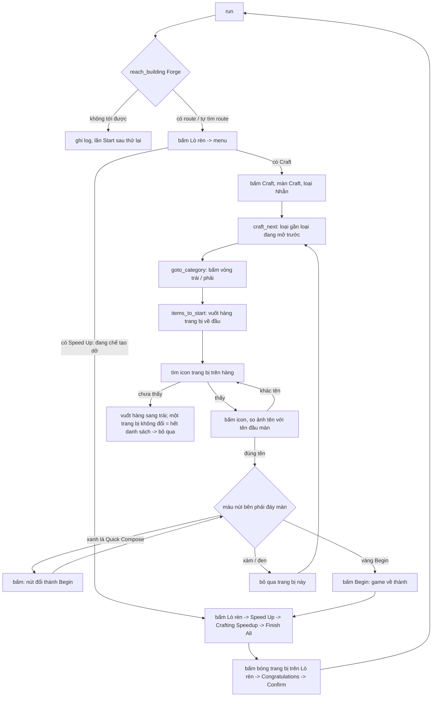

# Craft (chế tạo trang bị)

Tab **Craft** (ui/tabs/craft_tab.py): tích trang bị vàng trở lên cần chế tạo, mỗi trang bị một số lượng. Cấu hình (cột `craft` của DB):
`{"items": {"ring/03_Fearless_King's_Ring": 2, ...}, "claim_event_gifts": bool, "gift_order": [...]}` — `items` chỉ có trang bị đã tích.
**Chỉ chế tạo đúng các trang bị đã tích**, không đụng trang bị nào khác (kể cả trang bị xanh / tím).

## Điểm vào

- `run(bot, settings)` ở [run.py](run.py); dòng `craft` trong [bot/worker/priority.py](../../worker/priority.py): `priority` 669 (cao hơn mọi nhiệm vụ
  Daily Activities, cao nhất 668), `once` (một lần mỗi lần Start). `JOB.enabled`: có tích ít nhất một trang bị.
- Bị ngắt giữa chừng (boss / 120 giây) rồi gọi lại từ đầu: số còn lại của từng trang bị nhớ trong `_remaining` (theo thiết bị). Số này
  **chỉ trừ khi Lò rèn đã chế tạo xong** (sau Finish All, `consume_pending`): trang bị vừa bấm Begin được ghi vào `_pending` TRƯỚC khi bấm. Bị ngắt
  giữa chừng thì lượt sau mở menu Lò rèn: có `Speed Up` = đã bắt đầu -> tăng tốc, nhận, rồi mới trừ 1; không có = Begin chưa có hiệu lực -> bỏ dấu
  `_pending`, trang bị vẫn còn trong danh sách. Ví dụ cần 2 cái A, đã chế tạo xong 1: lượt sau còn A x1, làm đúng 1 cái nữa.
- Lỗi thì `@save_errors(KEY)` lưu `craft_error` vào DB.

## Vòng lặp chính

Lò rèn chỉ chế tạo **một** trang bị một lúc: Begin không bấm nhiều lần được, phải tăng tốc cho xong rồi mới làm cái tiếp. Số lượng N = lặp N vòng.

1. **Tới Lò rèn**: `city_map.reach_building(bot, "Craft", FORGE)` — đang thấy Lò rèn thì kéo vào giữa; máy đã có route thì đi theo route; **chưa có route thì
   tự tìm route** (`scan_city`, lưu DB) rồi đi. Sau đó `open_menu` (bấm giữa, tìm icon trong menu): `Speed Up` (đang chế tạo dở) trước, rồi `Craft`.
   Vào màn Craft luôn ở loại **Nhẫn**.
2. **Chọn loại** (`goto_category`): vòng chọn loại ở đáy, trái -> phải: mũ, giáp, quần, giày, nhẫn, cung, giáo, rìu, kiếm, chuỳ (`CAROUSEL`). Loại đang
   mở ở giữa nhận bằng ảnh `Images/Craft/Category/<loại>.png` (khớp 1,00 đúng loại, loại khác <= 0,83, ngưỡng 0,9). Cần loại bên trái thì bấm vòng nhỏ
   bên trái (121, 645), bên phải thì (272, 644), tới khi đúng loại; vòng không đổi sau 6 lần kiểm tra thì thôi (lượt sau làm lại).
3. **Tìm trang bị** (`craft_category`): vuốt hàng trang bị (y ~578) sang phải về đầu danh sách (`items_to_start`), rồi mỗi màn tìm icon của các trang bị
   cần làm (`candidates`: phần giữa 28x28 của `Images/Craft/<loại>/NN_<Tên>.png`, ngưỡng 0,65, bỏ viền vì trang bị đang chọn có viền vàng; đo trên màn thật: đúng 0,68 .. 1,00, trang bị khác <= 0,58); chưa thấy thì
   vuốt sang trái (chậm 2,5 s). **Mỗi cú vuốt so một trang bị ở giữa hàng (ô x 176..220) trước / sau: không đổi (sai khác trung bình < 20) = danh sách
   không cuộn nữa = đã ở cuối bên phải / trái, không vuốt tiếp** (đo trên 21943 / 21913: đang cuộn 50 .. 70, ở cuối bên phải 0,0 .. 0,1, ở đầu bên trái danh sách
   còn nảy lại nên 7 .. 14) -> ghi "not found in the list, skip".
   **Ô khoá** (`first_lock_x`): mỗi màn tìm `Images/Craft/lock.png` (10x10, giữa icon) trên hàng, ngưỡng 0,7 (ô khoá 0,72 .. 1,00, ô đã mở <= 0,46). Từ ô khoá
   đầu tiên tới hết danh sách đều chưa mở -> không chế tạo được: trang bị cần làm nằm ở ô khoá đó hoặc bên phải (tâm x >= x ổ khoá - 20) thì ghi "locked, skip"
   và bỏ qua; còn trang bị chưa thấy mà đã tới ô khoá thì ghi "behind a locked item, skip", bỏ qua hết và **không vuốt tiếp** loại này.
4. **Kiểm tra tên** (`title_matches`): bấm vào icon, so ảnh tên `Images/Craft/<loại>/name/NN_<Tên>.png` với tên ở đầu màn (vùng y 105 .. 155,
   ngưỡng 0,9). Khác tên (icon giống của trang bị khác) thì thử chỗ khớp tiếp theo.
5. **Nút bên phải đáy màn** (`button_state`, màu trung bình HSV của vùng 212..328 x 676..700) — `start_craft`:

   | Trạng thái | Màu (đo) | Làm gì |
   | --- | --- | --- |
   | `QUICK_COMPOSE` ("Quick Compose") | xanh lá, H 53 S 200 | bấm; chờ nút đổi thành Begin vàng (`wait_for_begin`: `bot.wait_for` ảnh `Craft/beginButton.png` (chữ Begin + nền nút, không lấy dòng thời gian; vàng 1,00 / xám 0,89 / Quick Compose <= 0,49, ngưỡng 0,95), mỗi 1 s, tối đa 8 s, tên vẫn đúng; không thì bỏ qua trang bị) rồi bấm Begin |
   | `BEGIN` ("Begin") | vàng, H 17 S 233 | bấm; game về thành (không còn tiêu đề Craft) = đã bắt đầu chế tạo |
   | `DISABLED` ("Begin") | xám / đen, S ~12 | không chế tạo được, bỏ qua trang bị này |

6. **Tăng tốc** (`forge_speed_up` -> `finish_crafting`): bấm Lò rèn -> menu có thêm `Speed Up` (tia chớp; KHÔNG bấm Cancel Crafting / Instant Finish) ->
   màn **Crafting Speedup** (giống Healing / Training Speedup, dùng vật phẩm tăng tốc): lần đầu `Speedup Settings >>` -> hộp Finish All (tích ô, Confirm); nút
   vàng `Finish All` (100, 674) -> về thành, hiện "Finished All Successfully!".
7. **Nhận trang bị** (`collect`): chờ 4 s, bóng trang bị vừa làm xong nổi trên Lò rèn (198, 222) -> bấm -> hộp "Congratulations on getting" -> `Confirm`
   (197, 566) -> về thành. Rồi vòng kế (hoặc xong khi hết số lượng).

## Trừ số lượng ở tab và log

- Mỗi trang bị chế tạo xong (sau Finish All, `consume_pending`) bot báo `bot.craft_done(item_id)` -> `BotWorker.craft_done` -> `BotManager.craft_done` -> `main._on_craft_done`
  -> `DeviceView.apply_craft_done` -> `CraftTab.craft_done`: số lượng ở tab **giảm 1, về 0 thì bỏ tích** (số lượng đặt lại 1), rồi lưu cấu hình mới vào DB. Tắt app
  bật lại / Start lại thì không chế tạo lại cái đã xong; người dùng tích lại khi muốn làm tiếp. Tab chưa dựng thì sửa cấu hình đang chờ (`_pending_settings`).
- Log (History, lưu DB bảng `logs`): mỗi trang bị xong một dòng `Craft: crafted Fighter's Bow (1/2)` (đã làm / số cần làm của lượt này), cuối lượt
  một dòng tổng kết `Craft: summary: Fighter's Bow x2, Fighter's Ring x1`. Trang bị bị bỏ qua có dòng riêng: `Begin disabled (not enough materials?), skip`, `locked, skip`,
  `behind a locked item, skip`, `not found in the list, skip`, `Begin not shown after Quick Compose, skip` (History).

## Ngưỡng đã đo

- Ảnh loại (`Craft/Category`, 60x60, tâm (196, 634)): đúng loại 1,00; loại khác cao nhất 0,83 (cung / kiếm).
- Nút: Quick Compose H 53 S 200; Begin vàng H 17 S 233; Begin xám S 12 -> ngưỡng S >= 120 mới tính là có màu.
- Icon trên hàng: bản cắt cùng icon 0,998 (Iron Ring thử sống); icon lưu cắt lệch vài px chỉ 0,68 .. 0,81 (Consul's / Officer's / vài áo giáp) -> ngưỡng 0,65. Tên: ảnh cắt từ chính màn Craft nên đúng 1,00; ngưỡng 0,9.
- `Craft/Menu/speedUp.png` 1,00 ở menu Lò rèn đang chế tạo, màn khác <= 0,38; `Craft/speedupTitle.png` (Crafting Speedup) 1,00, màn khác <= 0,41;
  `Craft/congrats.png` 1,00 / <= 0,37; `Craft/confirm.png` 1,00 / <= 0,39.

## Chạy thật (21943, 2026-10-23)

Thử trên Iron Ring (xanh, chỉ để thử, đã xoá ảnh tạm; **bot không chế tạo trang bị xanh**): `reach_building` -> menu -> Craft -> loại Nhẫn -> icon -> tên đúng ->
Begin -> về thành -> Lò rèn -> Speed Up -> Crafting Speedup -> Finish All -> bóng -> Confirm. Mất khoảng 90 s một vòng (vuốt hàng trang bị chậm chiếm
15 .. 30 s). Số lượng 2 chạy hết 2 vòng liên tiếp, xong tự dừng.

## Test

[tests/craft/test_flow.py](../../../tests/craft/test_flow.py): nhận nút theo màu, nhận loại, đi tới loại (trái / phải / đã đúng), tên trang bị, icon trên hàng, bấm
Begin / Quick Compose / bỏ qua Begin xám, nhận trang bị sau tăng tốc, màn Crafting Speedup, ảnh mẫu Speed Up / tiêu đề / Confirm. Ảnh thật ở tests/craft/screens/.

## Chưa biết / cần ảnh

- Màn Lò rèn rảnh -> Craft (dùng lại flow Refine, `menuCraft.png`) và hộp **Finish All / Speedup Settings** lần đầu của tài khoản chưa đặt: code theo Heal
  (đã chạy thật) nhưng chưa có ảnh chụp của Craft.
- Quick Compose bấm xong nút đổi thành Begin: theo lời người dùng, chưa chụp màn ngay sau khi bấm.
- Hết vật phẩm tăng tốc / Finish All không đủ: chưa biết màn báo; hiện sẽ không thấy bóng trang bị, ghi "finished item not collected" rồi dừng.
- Danh sách icon (Images/Craft/<loại>) lấy từ máy đã mở hết nên không có ô khoá; trên tài khoản chưa mở, icon bị ổ khoá che nên không khớp ảnh -> trang bị đó rơi vào "behind a locked item, skip".
- Chuỳ (staff) chưa có ảnh `active` riêng ở Refine; Craft dùng ảnh của mình (Craft/Category/staff.png).
