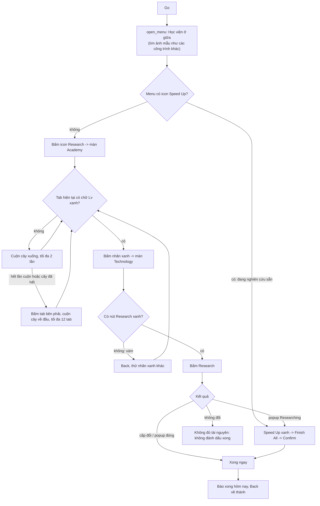

# Flow: Research technologies

Nhiệm vụ Daily Activities (ô tích **Research** ở tab Daily Activities). Ảnh / hằng số: [constants.py](constants.py),
code: [run.py](run.py). Phần chung (mở Quests → Activity, tìm dòng "Research technologies", bấm Go):
[../OPEN_TASK.md](../OPEN_TASK.md). Dòng này cũng là đường tắt của Resource Collecting
([../resource_collecting/FLOW.md](../resource_collecting/FLOW.md)); hai nhiệm vụ độc lập nhau.

- **Chữ xanh không đủ để biết học được**: "Lv0 / 10" của công nghệ thiếu điều kiện vẫn xanh. Quyết định cuối là nút
  **Research xanh** ở màn Technology (xám = thiếu tài nguyên hoặc thiếu cấp công nghệ / Học viện, dòng điều kiện có
  dấu X đỏ). Nút xám khớp ảnh mẫu 0,75, nút xanh 1,00 (ngưỡng mặc định 0,9).
- `green_levels` tìm nhãn bằng mặt nạ màu HSV trong vùng cây (y 190–690), chỉ lấy khối rộng 40–70 px, cao 6–14 px
  (loại icon xanh và mũi tên). Công nghệ tối đa (Lv10 / 10) hiện chữ trắng nên không bị chọn.
- Chữ vàng = tối đa (Lv10 / 10), không chọn. Tab chỉ có vàng / trắng thì cuộn cây xuống (tối đa 2 lần, dừng sớm khi
  cây không đổi sau khi vuốt) rồi sang tab kế bên. Chuyển tab xong cuộn cây ngược về đầu.
- Nghiên cứu 0 giây (nút ghi 00:00:00) xong ngay, màn Technology vẫn mở với cấp mới. Còn lại hiện popup
  "Researching": chỉ bấm **Speed Up xanh** (vật phẩm), không bấm nút Speed Up có kim cương.
- Học viện đang nghiên cứu sẵn (menu có thêm Speed Up, Cancel Research, Instant Finish): chỉ bấm icon **Speed Up**
  (tia sét xanh), rồi Finish All -> Confirm. Không bấm Instant Finish (tốn kim cương).
- Popup Finish All có ô tích "You can use corresponding common speedups...": chưa tích thì tích trước khi Confirm.
- Back về thành tới khi hết màn Technology / Speedup / Academy.
- Ảnh test: `tests/daily_activities/alliance_research/screens/`.
