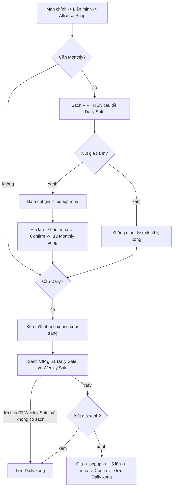

# Flow: Alliance VIP

Nhiệm vụ Daily: mua sách "100 VIP Points" ở Alliance Shop, hai loại (Monthly và Daily). Ô tích **Alliance VIP** ở tab Daily
Activities, mặc định tích (thiếu cấu hình = tích). Ảnh / hằng số: [constants.py](constants.py), code: [run.py](run.py). Không nhận thưởng
sau khi mua: mua xong là xong.

Mỗi loại có dấu "xong hôm nay" riêng trong `daily_done`: `Alliance VIP: Monthly`, `Alliance VIP: Daily`. Cả hai có thì nhiệm vụ xong
(`JOB["done"]`); chỉ phần còn thiếu được làm.

- **Phân biệt hai sách bằng tiêu đề nhóm**: Monthly nằm trên tiêu đề "Daily Sale" (`DailySale.png`, đầu trang), Daily nằm giữa "Daily Sale"
  và "Weekly Sale" (`WeeklySale.png`, ở cuối trang, ngay dưới sách Daily). Tiêu đề nào ra khỏi màn thì dùng tiêu đề còn lại.
- **Nút giá**: xanh (độ bão hoà màu >= 100) = mua được; xám (VD chưa có thẻ tháng, độ bão hoà ~35) = coi như đã mua, đánh dấu xong
  luôn. Bấm **nút giá** mới hiện popup mua (bấm vào sách thì không).
- **Popup mua**: bấm giá xong chờ 1 giây, chưa có popup (tìm nút "+") thì chờ thêm tối đa 5 lần (1 giây / lần); sau 5 lần vẫn không có
  popup thì vẫn lưu xong. Có popup: bấm "+" 5 lần rồi bấm nút mua (dưới thanh số lượng) -> hiện hộp xác nhận -> bấm **Confirm** mới là mua thật, SAU ĐÓ mới lưu DB. Chờ Confirm tối đa 5 giây; không có Confirm mà popup mua còn mở, hoặc sau Confirm hộp vẫn còn thì Back, không lưu.
- **Cuộn**: vừa vào shop KHÔNG cuộn lên (đầu trang sẵn). Monthly xong thì kéo thật nhanh xuống cuối (6 lần vuốt 0,15 giây, không chờ giữa
  các lần), chờ 1,5 giây cho shop hết trôi rồi tìm. Không bao giờ cuộn lên: ở cuối mà chưa thấy tiêu đề Weekly Sale thì chỉ chụp lại (tối đa 6 lần, 1 giây / lần), vẫn không thấy thì dừng, không lưu.
- **Lỗi / không tới được shop**: không lưu dấu, lần sau làm lại; lỗi lưu `daily_alliance_vip_error` vào DB.

## Số đo (máy 21913, 396x704)
- Dòng "Alliance Shop" ở màn Liên minh 1,00; tiêu đề shop 1,00. Sách VIP: Monthly (206, 218) 1,00, Daily 0,90..0,92 (ngưỡng 0,85).
- Tiêu đề "Daily Sale" (199, 494) 1,00; "Weekly Sale" (199, 543 khi hiện) 1,00. Nút "+" của popup khớp 0,98 với ảnh của Buy Stamina.
