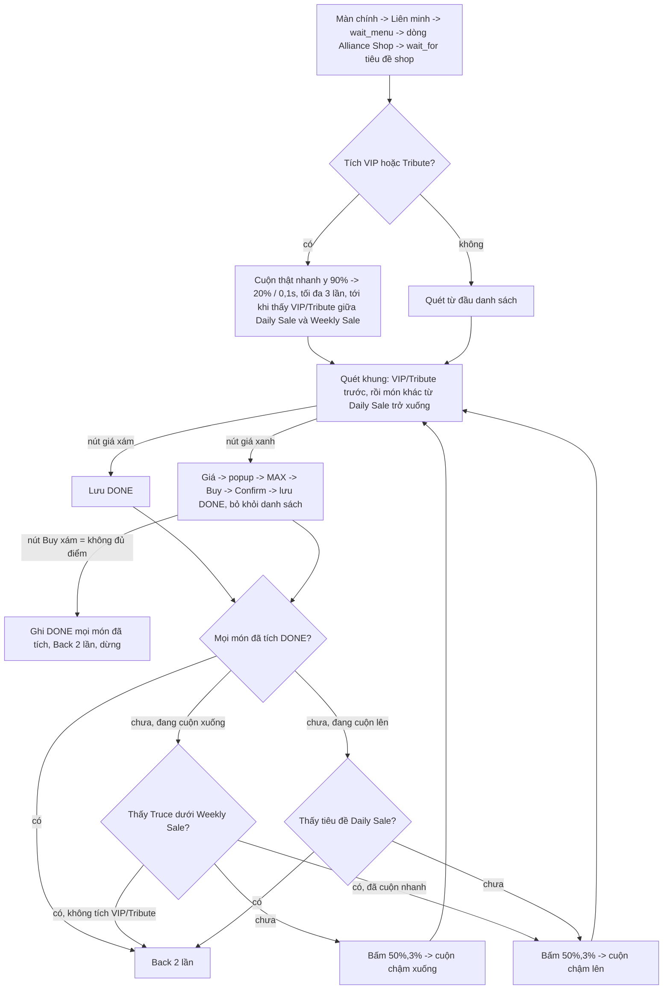

# Flow: Alliance Shop (key `Alliance VIP`)

Nhiệm vụ Daily: mua các vật phẩm đã tích ở group **Alliance Shop** (tab Daily Activities). Ô tích **Alliance Shop** mặc định tích
(thiếu cấu hình = tích). Ảnh / hằng số: [constants.py](constants.py), code: [run.py](run.py). **Chỉ mua từ tiêu đề "Daily Sale" trở
xuống**: Monthly ở đầu shop (trên Daily Sale) không mua nữa.

Dấu "xong hôm nay" trong `daily_done`: VIP = `Alliance VIP: Daily`, Tribute = `Alliance VIP: Tribute Daily`, món khác =
`Alliance VIP: <key>`. Việc xong hôm nay (`JOB["done"]`) khi mọi món **đang tích** đều có khóa riêng: tích thêm món mới thì bot làm tiếp.

- **Thứ tự trong shop** (đo trên 21913): Monthly -> **Daily Sale** -> tài nguyên 100K / 500K -> Truce -> Chips -> **VIP, Tribute** ->
  **Weekly Sale** -> **Truce 8h / 24h / 3d** (hàng cuối).
- **Vùng mua theo tiêu đề nhóm**: chưa thấy "Daily Sale" (`DailySale.png`) thì không mua gì. VIP / Tribute chỉ tìm giữa "Daily Sale" và
  "Weekly Sale" (`WeeklySale.png`); món khác tìm từ "Daily Sale" tới đáy. Cuộn nhanh xong coi như đã qua tiêu đề Daily Sale.
- **Giới hạn cuộn**: xuống tới khi thấy Truce nằm dưới tiêu đề Weekly Sale; lên tới khi thấy tiêu đề Daily Sale. Mua đủ mọi món đã
  tích thì dừng ngay, không cần chạm giới hạn.
- **Trước mỗi lần cuộn** (nhanh / chậm, lên / xuống) bấm (50%, 3%) = tiêu đề shop, **chỉ khi đang thấy màn Alliance Shop** (tiêu đề shop): lỡ bấm trúng vật phẩm thì shop không cuộn được.
- **Nút giá**: xanh (độ bão hoà màu >= 100) = mua được; xám (VD chưa có thẻ tháng, độ bão hoà ~35) = coi như đã mua, đánh dấu xong
  luôn. Bấm **nút giá** mới hiện popup mua (bấm vào sách thì không).
- **Ba Truce Agreement** dùng cùng hình con chim nên không chỉ dựa vào
  điểm template. Sau khi khớp hình, bot so thêm histogram HSV của nền:
  `8h` tím, `24h` cam, `3d` vàng. Bot luôn chọn loại có dải màu
  gần nhất, không có nhánh PENDING do ngưỡng màu. Nếu khung hiếm khi
  không đủ pixel bão hòa, bot phân loại bằng độ tương đồng full-colour.
- **Chờ chuyển màn**: mọi lần bấm sang màn mới đều `wait_for` ảnh của màn đích, 1 giây kiểm tra một lần, tối đa 6 lần
  (`WAIT_INTERVAL`, `WAIT_TIMEOUT`): dòng "Alliance Shop" -> tiêu đề shop; nút giá -> dấu "+" của popup (thấy rồi chờ thêm 1 giây cho popup mở hẳn);
  nút mua -> **Confirm**. Bấm nút Liên minh dùng `no_alliance.wait_menu` (chờ menu Liên minh hoặc màn "chưa có liên minh").
- **Popup mua**: không thấy popup sau 6 lần thì giữ PENDING. Có popup: chọn MAX rồi bấm nút mua (dưới thanh số lượng) -> hộp xác nhận
  -> bấm **Confirm** mới là mua thật, SAU ĐÓ lưu DB luôn (không chờ nút giá xám) và bỏ món đó khỏi danh sách. Không có Confirm mà popup mua còn mở, hoặc sau
  Confirm hộp vẫn còn thì Back, không lưu.
- **Chọn MAX**: bấm đầu thanh bên trái dấu "+", thấy thanh xanh MAX là xong. Chỉ còn 1 lượt (VD 100 Chips "1 / 1") thì thanh không
  kéo được: bấm 2 lần mà thanh không đổi thì coi như đã MAX. Nút Buy xám ở MAX = không đủ Alliance Points (VD Food 100K 200 x 9.000 =
  1.800.000): ghi DONE mọi món đã tích và dừng.
- **Cuộn chậm**: bấm dòng "Alliance Shop" vào shop thì danh sách luôn ở đầu, không cần cuộn lên. Quét/mua mọi món đang thấy rồi
  mới vuốt chậm 1 giây (`SWIPE` xuống / `SWIPE_UP` lên) và chờ thêm 1 giây. Trần an toàn `SCROLLS` = 32 lượt.
- **Lỗi / không tới được shop**: không lưu dấu, lần sau làm lại; lỗi lưu `daily_alliance_vip_error` vào DB.

## Số đo (máy 21913, 396x704)
- Dòng "Alliance Shop" ở màn Liên minh 1,00; tiêu đề shop 1,00. Sách VIP: Monthly (206, 218) 1,00, Daily 0,90..0,92 (ngưỡng 0,85).
- Tiêu đề "Daily Sale" (199, 494) 1,00; "Weekly Sale" (199, 543 khi hiện) 1,00. Cuộn nhanh 90% -> 20% / 0,1s: cú 2 thấy Tribute
  (321, 492) 0,89 và VIP (82, 504) 0,86 ngay trên Weekly Sale (199, 628); cú 20% -> 300% không cuộn. Nút "+" của popup khớp 0,98 với ảnh của Buy Stamina.
