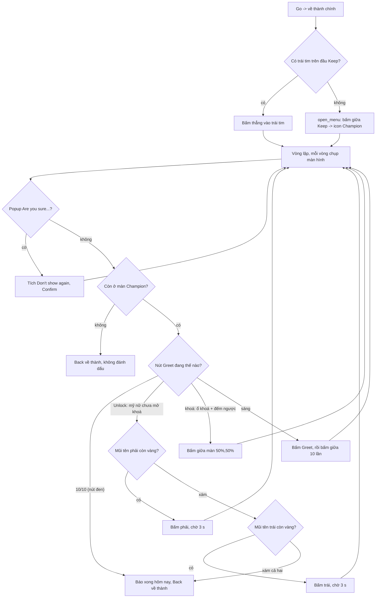

# Flow: Greet Champion

Nhiệm vụ Daily Activities "Greet the Champion 2 time(s)." (ô tích **Greet Champion** ở tab Daily Activities, ưu tiên
385). Ảnh / hằng số: [constants.py](constants.py), code: [run.py](run.py). Phần chung (mở Quests → Activity, tìm
dòng, bấm Go): [../OPEN_TASK.md](../OPEN_TASK.md).

Chào cho đủ **10/10** (không chỉ 2 lần). Cả nhiệm vụ không chờ giây nào, **trừ 3 s sau khi bấm mũi tên** đổi mỹ nữ.

- Chỉ khi thấy nút **Unlock** mới đổi mỹ nữ (phải trước, xám thì sang trái). Mũi tên còn bấm được màu vàng (độ bão hoà
  ~130-160), hết đường thì xám (~3).
- Greet 10/10: nút đen, chữ "10/10" (`GreetFull.png`, khớp 1,00; "0/10" 0,68, "2/10" ≤ 0,63, ngưỡng 0,9). Bấm vào chỉ
  hiện "Purchase the Champion Monthly Card...".
- Đủ `GREET_REQUIRED` = 2 lần chào (bot đếm `daily_greet_champion_greet_<n>` trong DB): **lưu ngay "xong hôm nay"** rồi chào tiếp tới 10/10 / hết mỹ nữ / bị ngắt; hai trường hợp đầu lưu thêm `daily_greet_champion_more`. Không còn `must_finish`.
- Việc nối tiếp `daily_greet_champion_more` (`run.MORE_JOB`, ưu tiên 385, không đi qua Go): bỏ qua khi Daily Greet chưa xong / đã lưu more / đủ 10 lần; chạy: về thành → tới Keep (`city_map.reach_building`: thấy Keep thì làm luôn; có route thì `goto`; chưa có route thì `scan_city` tìm và lưu DB rồi `goto`) → trái tim hoặc Keep → Champion → cùng vòng chào → lưu `daily_greet_champion_more`.
- Giới hạn cả nhiệm vụ `TASK_MAX_SECONDS` = 600 s (10 lần Greet ~ 10 phút).
- Giao diện Activity **bản cũ** (lưới thẻ): không làm nhiệm vụ này. Không có `Card.png` nên `open_task` trả TASK_UNKNOWN, bỏ qua, không đánh dấu.
- Keep là công trình cố định ở giữa thành (như Gold Levy) nên dùng chung `open_menu` + `KEEP`.
- Ảnh mẫu cắt từ ảnh chụp giả lập 396x704 (2026-10-13), thư mục `Images/DailyActivites/ActivitiesGreetChampion/`:
  `Title`, `Heart`, `Champion` (icon menu), `ChampionTitle`, `Greet`, `GreetFull`, `Unlock`, `DontShow`, `Confirm`.
- Back chỉ khi mất nút ••• (có popup); Back ở màn thành sạch = hỏi thoát game.
