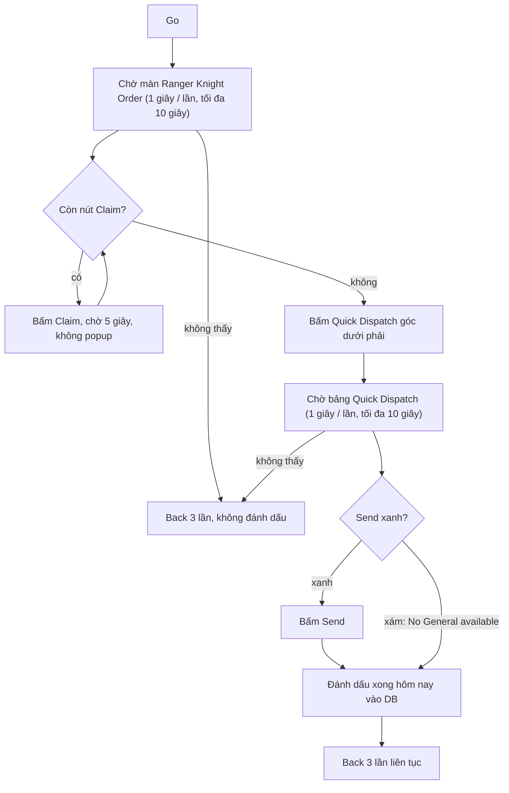

# Flow: Ranger Knight Order

Nhiệm vụ Daily Activities "Ranger Knight Order" (ô tích **Ranger Knight** ở tab Daily Activities, ưu tiên 384). Ảnh /
hằng số: [constants.py](constants.py), code: [run.py](run.py). Phần chung (mở Quests → Activity, bấm Go):
[../OPEN_TASK.md](../OPEN_TASK.md).

- Ảnh mẫu cắt từ ảnh chụp giả lập 396x704 (2026-10-16) vào `Images/DailyActivites/ActivitiesRangerKnight/`.
- `Card.png`: thẻ bản cũ (icon số 4 trong lưới Activity).
- `ScreenTitle.png`: tiêu đề màn "Ranger Knight Order" sau Go (cắt 2026-10-24). Không dùng `Title.png` — đó là tiêu
  đề dòng trong danh sách Activity của phần mở nhiệm vụ chung.
