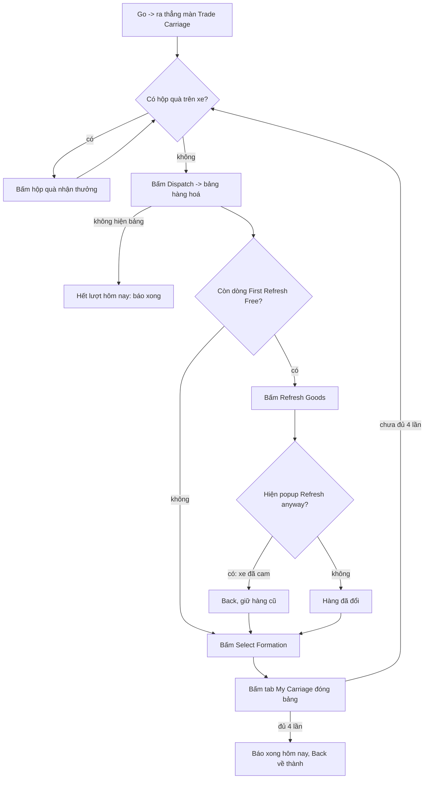

# Flow: Trade Carriage

Nhiệm vụ Daily Activities "Dispatch Trade Carriages 1 time(s)" (ô tích **Trade Carriage** ở tab Daily Activities, ưu
tiên 301: nhiệm vụ cuối cùng trước nhận thưởng Activity). Ảnh / hằng số: [constants.py](constants.py), code:
[run.py](run.py). Phần chung (mở Quests → Activity, tìm dòng, bấm Go): [../OPEN_TASK.md](../OPEN_TASK.md).

- Mỗi ngày game cho 4 lượt ("Transports Left Today"); bot Dispatch tối đa `DISPATCH_MAX` = 4 lần.
- Chỉ bấm Refresh Goods khi còn chữ "First Refresh Free" (lượt free); hết free thì không bấm (tránh tốn vật phẩm).
- Ảnh mẫu cắt từ ảnh chụp giả lập 396x704 (2026-10-13), thư mục `Images/DailyActivites/ActivitiesTradeCarriage/`.
