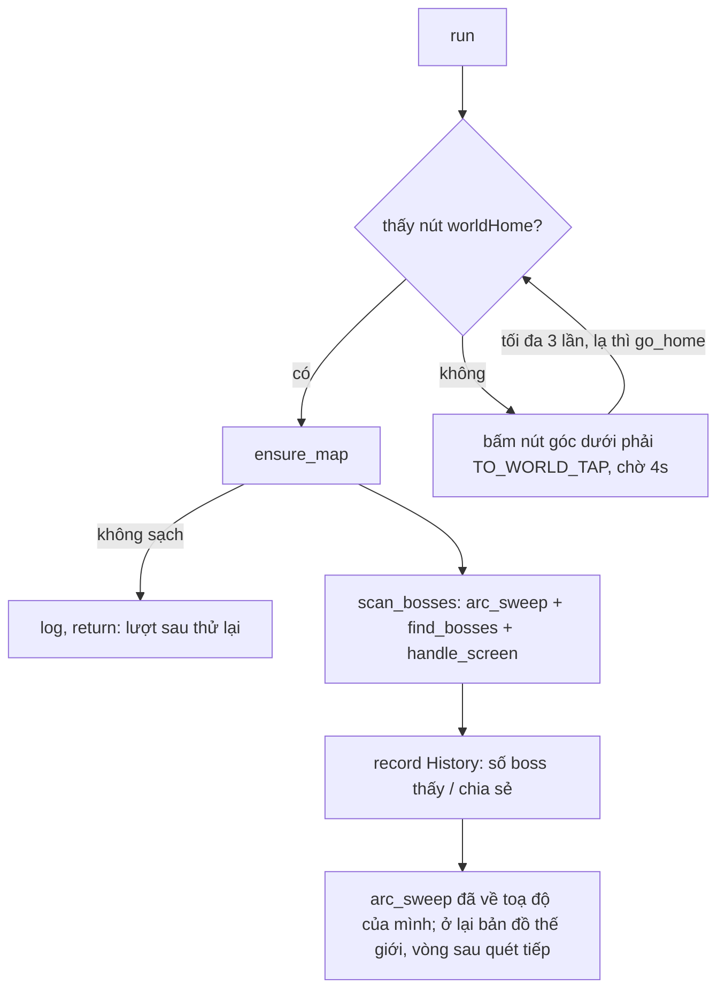

# Find Boss — flow

## Điểm vào
- `run(bot, settings)` ([run.py](run.py)), tab "Find Boss" (`settings["Find Boss"]`): `start_deg`, `end_deg` (góc màn hình, 0° = phải, ngược chiều kim đồng hồ), `radius` (km), `share` (chia sẻ boss đang tích vào liên minh); `selected_bosses` (không có Viking).
- Worker gọi qua dòng `find_boss` trong [bot/worker/priority.py](../../worker/priority.py) (nhóm "Find Boss", ưu tiên 700, `idle_only`): `JOB = {run, enabled}`, bật khi đã tích ít nhất một boss. Lỗi thật lưu `find_boss_error`.
- Một lần gọi = một vòng quét; không có ô Every, không lưu "xong": rảnh là quét tiếp liên tục.

## Khi nào chạy
Chỉ khi **rảnh**: dòng `find_boss` có `idle_only` ([priority.py](../../worker/priority.py)); worker ([bot_worker.py](../../worker/bot_worker.py)) chỉ gọi nó khi không còn nhiệm vụ nào khác tới lượt (kể cả việc theo giờ chưa tới giờ). Quét xong (arc_sweep bấm nút về toạ độ của mình) thì worker xét lại, hết nhiệm vụ khác thì quét tiếp ngay. Đang quét mà có nhiệm vụ khác tới lượt (việc theo giờ như Alliance Donation / Help tới giờ, City VIP và việc 0h, ...) thì quét bị ngắt (`YieldToTask`, worker xét mỗi 5 giây), làm xong nhiệm vụ đó rồi quét lại từ đầu; Join Monster War, Bubble, Auto Times Out và reset server cũng ngắt như thường. Không bị giới hạn 120 giây, và boss mới không ngắt cả lượt quét: giống tìm công trình (scan_city), **sau mỗi cú kéo** (`arc_sweep.WATCH_EVERY = 1`) `arc_sweep` gọi `bot.swipe_watch` (worker gán khi chọn Join Monster War): đọc số boss ở icon listboss, tăng thì vào Join Monster War tới khi rảnh; sau đó `bot.swipe_recover` đưa game về bản đồ thế giới (Back khi còn popup, không bấm về thành) và quét tiếp ngay từ ô đang dở. Chỉ khi đọc thấy camera đã lệch hơn 6 km so với ô dự tính thì mới bấm nút về thành rồi kéo lại tới ô đó.

## Vòng chính

`scan_bosses` (bot/common/boss_scan.py): mỗi ô của arc_sweep nhận boss, `share=True` thì chia sẻ boss đang bật chưa chia sẻ (danh sách chung theo `bot.server`; chưa biết server thì không chia sẻ). Xem [arc_sweep.py](../../common/arc_sweep.py).

## Thứ tự nhận diện
Không dùng vòng `_targets()`: nhận màn bằng `worldHome.png` (ngưỡng 0.8) và `ensure_map` (độ sáng biểu tượng cố định).

## Ngưỡng đã đo
`worldHome` 0.8 theo arc_sweep.go_home. `TO_WORLD_TAP = (92, 93)` % **chưa đo**.

## Test
[tests/find_boss/test_flow.py](../../../tests/find_boss/test_flow.py): bot giả + `scan_bosses` giả (chưa có ảnh chụp thành → thế giới nên chưa theo chuỗi ảnh): ra thế giới, góc / bán kính / share, chỉ boss được tích là active, bỏ Viking, chưa tích boss thì bỏ qua, chia góc Auto ([angles.py](angles.py)), dòng worker. Chạy tay thật: `tests/run_boss.py`.

Cấu hình thêm: `selected_bosses` (như tab Join Monster War, không có Viking); Auto chia góc cho mọi máy cùng server (main.py `_on_auto_angles`).

## Chưa biết / cần ảnh
- Icon listboss (đếm số boss mới) có hiện trên bản đồ THẾ GIỚI không (hiện đọc ở cột phải, `BOSS_ICON_REGION`); không thấy icon thì số boss = 0 và không bao giờ vào Join Boss giữa chừng.
- Ảnh nút "ra thế giới" ở góc dưới phải màn thành (hiện bấm theo %, cần chụp để thay bằng template).
- Ảnh flow test: thành, thế giới, kết thúc quét.
- Quét cả vòng 300 km rất lâu; nên chạy khi không chọn Join Monster War (không bị cắt 120 giây) hoặc đặt `must_finish` nếu cần.

## Nhiều boss trên một màn (danh sách chờ)
Mỗi boss cần xử lý thấy ở ô hiện tại được nhớ theo toạ độ thế giới (`waiting` trong `handle_screen`). Sau mỗi lần kéo / bấm (camera dời), hướng tới từng boss được tính lại từ toạ độ camera đọc ở thanh X:Y (`screen_of`), không cộng dồn các cú kéo. Xử lý xong boss ở màn hiện tại mà danh sách còn thì kéo tới boss kế theo hướng đó (boss ở góc trên-trái trước), tìm lại và xử lý, lặp tới khi hết danh sách. Mỗi boss kéo tới tối đa 3 lần; đứng trong màn hình mà không có việc (đã xử lý / bỏ qua) thì bỏ khỏi danh sách.
