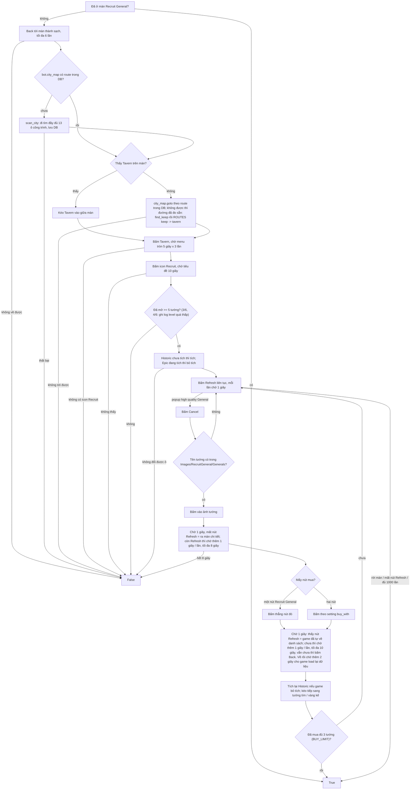

# Flow: Recruit General

Activity **chạy một mình** (`EXCLUSIVE_ACTIVITIES` trong [../constants.py](../constants.py): không Bubble, không nhiệm vụ khác).
Code: [run.py](run.py), ảnh / hằng số: [constants.py](constants.py).

**Điểm vào:** `run(bot, settings)`; settings của tab: `{"buy_with": "Recruit General" | "Buy General Token"}` (group Setting, radio, chỉ một nút được tích; chọn nút bấm ở màn chi tiết tướng khi có hai nút). Trả `True` khi tới màn Recruit General, `False` khi không tới được. Chọn
bằng nút Recruit General ở tab Initialization (tích nút này thì bỏ tích các nút khác).

Đã ở màn Recruit General thì bỏ qua các bước tới đó, chỉ chỉnh hai ô rồi Refresh. Confirm của popup chỉ bấm sau khi đã kiểm tra hết tướng xịn (không mua, hoặc mua xong): Refresh lại rồi bấm Confirm (`_refresh_confirm`).

**Tướng cần mua:** các tên đã tích ở UI (`settings["generals"]`). Bot đọc tên tướng đang hiện bằng OCR (`bot/ocr/read_general_name.py`, mẫu chữ ở `Images/OCR/GeneralName/`), so mờ với từng tên đã tích: chỉ chữ cái (bỏ phần trong ngoặc, `i` = `l`); chữ OCR chỉ cần nằm TRONG tên là được (VD `?athanael` khớp "Nathanael Greene"): số chữ khớp / số chữ OCR đọc được từ 50% (`NAME_MATCH`) và khớp ít nhất 3 chữ thì mua. Chưa tích tướng nào = không mua, Refresh tiếp. Tên OCR có `?` thì lưu ảnh dải tên vào `%LOCALAPPDATA%\EvonyBot\logs\generals\` để thêm mẫu. Mua: bấm giữa ảnh tướng (`GENERAL_ART`) -> màn chi tiết tướng (nút `DetailRecruit.png` "Recruit General" + giá, `DetailBuyToken.png`; 1,00, màn Tavern <= 0,37). Màn chi tiết có hai kiểu: hai nút (Recruit General + Buy General Token) hoặc MỘT nút Recruit General ở giữa (một số tướng). Ảnh là phần chữ của nút (không kèm giá): `DetailRecruit.png` 1,00 ở cả hai kiểu; `DetailBuyToken.png` 1,00 ở kiểu hai nút, kiểu một nút 0,46 (ngưỡng 0,9). Một nút -> bấm thẳng; hai nút -> bấm theo `buy_with`. Bấm nút xong game tự về màn danh sách tướng: `_wait_list` chờ 1 giây / lần (thấy nút Refresh của Tavern = đã về), tối đa `LIST_WAIT` = 10 giây, quá hạn thì Back (dự phòng). Popup xác nhận / màn kết quả giữa chừng (nếu có) chờ ảnh.

## Nhận diện

| Ảnh | Việc | Ngưỡng | Điểm đã đo |
| --- | --- | --- | --- |
| `MenuRecruit.png` | icon Recruit trong menu tròn Tavern | 0,8 | 1,00; màn Recruit General 0,35 |
| `Title.png` | tiêu đề màn Recruit General | 0,8 | 1,00; màn menu Tavern 0,21 |
| `BoxChecked.png` | dấu tích xanh, tìm trong vùng từng ô (`EPIC_REGION`, `HISTORIC_REGION`) | 0,8 | ô tích 0,93..1,00; ô chưa tích <= 0,11 |
| `Refresh.png` | nút Refresh | 0,8 | 1,00; menu Tavern 0,34 |
| `HighQualityPopup.png` | chữ popup "Your Tavern has a high quality General" (xét TRƯỚC: tiêu đề / Refresh vẫn khớp 0,99 dưới popup) | 0,8 | 1,00; màn thường 0,30 |
| `Cancel.png` | nút Cancel của popup | 0,8 | 1,00; màn thường 0,45 |
| ảnh Tavern (`Images/Building/civ1..7/tavern/1.png`, có đủ 7 civ; Tavern là công trình cố định) | tìm Tavern trên màn | `BUILDING_THRESHOLD` | chưa đo trên máy thật |

Test: `tests/recruit_general/test_flow.py` (ảnh trong `tests/recruit_general/screens/`; trạng thái ô tích khác là ảnh tổng hợp dán ô thật lên).
Ảnh chụp 396x704 (2026-10-16): `Screenshot_20261016-211005.png` (menu Tavern), `-211049.png` (màn Recruit General).

## Thanh chấm màu 6 tướng

Dưới ảnh tướng có 6 chấm, mỗi tướng một chấm theo phẩm chất: trắng / xanh lá / xanh dương / **tím** / **vàng**. Bot KHÔNG lọc theo
màu (chỉ theo vương miện, xem dưới), màu chỉ ghi log. Số chấm = số tướng đã mở (chữ "Unlocked Generals: n/6" ở góc trên), **từ 3 đến 6** (tài khoản yếu chỉ 3; đã đo ảnh thật 3/6, 4/6, 5/6 và 6/6, bố cục căn giữa đúng): chấm nằm một hàng (`DOT_Y_PCT`), cách đều, căn giữa màn; `run.dot_xs(screen)` thử n = 6 xuống 3, lấy n lớn nhất mà mọi vị trí của bố cục n chấm đều là chấm (màu tâm đọc được và khác nền hai bên); `run.dot_colors(screen)` đọc màu ở tâm từng chấm
(Hue HSV: vàng 23, lá 53, dương 101, tím 149; bão hoà thấp = trắng).
Chấm của tướng đang hiện to hơn, có viền vàng (và vương miện nếu tím / vàng) nhưng màu ở tâm vẫn đúng. Ảnh bị popup làm mờ vẫn đọc
đúng (sáng ~50..75, `DOT_MIN_VALUE` = 30).

### Vương miện và tướng đang hiện

- **Vương miện** nhỏ vàng trên chấm = tướng XỊN (tím / vàng). Mọi tướng xịn đều có, có thể 2 tướng cùng lúc (hiếm, ảnh `08_two_generals.png`:
  tím ở chấm 1, vàng ở chấm 5). Bot chỉ quan tâm tướng CÓ vương miện, KHÔNG xét màu chấm. `run.crowned_slots(bot, screen)` trả danh sách
  chấm có vương miện: đếm điểm cam vàng ĐẬM phía trên chấm (Hue 20..30, bão hoà > 200, sáng > 150; có vương miện 5..9 điểm, không có 0) HOẶC tìm
  `Crown.png` / `Crown2.png` / `Crown3.png` quanh chấm (ngưỡng 0,75). Ảnh mẫu khớp không đều theo nền (0,70 ở ảnh 11, 0,52 ở ảnh 15 vì nền váy trắng)
  nên màu là cách chính; ảnh mờ dưới popup không đủ sáng cho màu nên dùng ảnh mẫu (Crown2 1,00). Viền thêu vàng trên váy tướng (ảnh 15, Hue 15..17,
  bão hoà ~170) không phải vương miện nên ngưỡng màu loại nó.
- **Tướng đang hiện** = chấm có viền vàng sáng quanh (không liên quan vương miện): `run.shown_slot(screen)` đếm điểm vàng trên nửa dưới
  vòng bán kính 6 px quanh mỗi chấm, chấm nhiều điểm nhất (>= 2) là tướng đang hiện. Đo: chấm đang hiện 4..7 điểm (ảnh mờ 2), chấm khác 0. Đã đo với chấm đang hiện đủ 5 màu: xanh dương (02), tím (03, 07), vàng (04, 08, 10), trắng (09), xanh lá (11).

Sau Cancel (`_handle_generals`): không chấm nào có vương miện -> Refresh tiếp. Có -> kiểm tra tên tướng đang hiện (nếu nó có vương miện),
rồi kéo sang từng tướng có vương miện còn lại (gần trước) kiểm tra tên; tướng nào cần mua thì mua.

### Chuyển sang tướng khác

Muốn xem tướng khác chỉ cần kéo ảnh tướng sang trái hoặc phải (`SWIPE_LEFT` / `SWIPE_RIGHT`, giữa ảnh tướng); vương miện chuyển theo
sang chấm của tướng mới. `_goto_slot` kéo tới tướng có vương miện khác. Hướng đầu theo vị trí: đích bên phải thì kéo sang trái (giả định = tướng bên phải), đích bên trái
thì kéo sang phải; sau một lần kéo mà tướng đang hiện (viền vàng) xa chấm đích hơn thì đổi hướng; đến đích khi tướng đang hiện là chấm đích;
tối đa `SWITCH_MAX` = 8 lần kéo.
Hướng kéo và độ trượt (một lần kéo = một tướng?) chưa kiểm chứng trên máy thật.

**Kiểm tra đã kéo xong:** chỉ cần tướng đang hiện (viền vàng quanh chấm, `shown_slot`) sang chấm khác là đủ, KHÔNG kiểm tra ảnh tướng
(hai tướng giống nhau thì ảnh không đổi). Trước khi kéo ghi lại chấm đang hiện; kéo xong kiểm tra 1 giây / lần, tối đa 8 giây (`SWIPE_CHANGE_WAIT`);
chấm vẫn đứng yên sau 8 giây thì kéo lại (tính vào `SWITCH_MAX`). Không đọc được chấm trước khi kéo thì chờ 1 giây rồi `_goto_slot` đọc lại
(`_swipe_until_changed`). Đo trên máy 21963: một lần kéo đổi đúng một chấm, mất 3..4 giây (phần lớn là thời gian chụp màn hình).

### Level quá thấp

Chỉ mở 3/6 hoặc 4/6 tướng (ít hơn `MIN_GENERALS` = 5 chấm) thì Tavern chưa đủ level để roll ra tướng xịn: ghi log "only n/6 Generals unlocked, Tavern level too low to roll a high quality General, stop" rồi dừng activity (`run` trả `False`, không bấm gì). Số tướng đã mở = số chấm (không đọc chữ "n/6" bằng OCR). Không đọc được chấm nào thì cứ đi tiếp.

### Đường tới Tavern

1. Máy chưa có route trong DB -> `scan_city` đi tìm đầy đủ 13 ô công trình rồi lưu DB (mất khoảng 5 phút, chỉ lần đầu).
2. Tavern đang trên màn -> kéo vào giữa. Không thì `city_map.goto` theo route trong DB.
3. `goto` không được (không thấy công trình đã biết nào trên màn...) -> đường ĐÃ ĐO sẵn của civ (`city_tour.py` ROUTES): `find_keep` về Thành chính
   rồi `ROUTES[("keep", "tavern")]` (civ1: 1 cú vuốt), kéo Tavern vào giữa.

### Sau khi mua

Mua xong bot vẫn Refresh tiếp để săn tướng xịn kế tiếp; mua đủ `BUY_LIMIT` = 3 tướng trong một lượt chạy thì ghi log "bought 3 General(s), stop" rồi dừng
(`_refresh` đếm số tướng `_handle_generals` đã mua). Test thật trên 21913 (2026-10-16): mua 1 tướng (Yi Song-gye) bằng nút Recruit General ở màn một nút,
game hiện "You have recruited ..." rồi tự về màn danh sách.

## Thiếu vàng (Open Gold)

Bấm nút mua mà không đủ vàng thì game mở màn "How to get" (danh sách rương vàng) thay vì mua (`HowToGetTitle.png`).
- Tab KHÔNG tích "Open Gold": Back hai lần về danh sách tướng rồi DỪNG activity (bot dừng).
- Tab tích "Open Gold": bấm "Use" (`ListUse.png`, cột nút bên phải) của từng rương từ trên xuống, tới khi không còn nút Use nào trên màn (rương còn lại là nút kim cương = hết vàng) rồi Back về màn mua.
  Mỗi rương hiện popup số lượng: nút trái là "Minimum" (`PopupMinimum.png`) nghĩa là thanh trượt đã ở tối đa -> bấm "Use" (`PopupUse.png`); nút trái ghi "Max" (`PopupMax.png`, thanh trượt chưa ở tối đa) -> bấm Max rồi mới bấm Use. Xong Back về màn chi tiết, bấm lại nút mua; vẫn thiếu vàng thì Back về danh sách rồi dừng activity.
Rương chỉ có một: bấm Use dùng luôn, không popup (danh sách đổi = đã dùng). Use xong về danh sách, mở tiếp tới khi hết chữ Use; Back về màn chi tiết chờ bằng wait_for 1 giây / lần tối đa 10 giây. Chưa có ảnh: popup kết quả sau Use (nếu có).
Sau khi bấm Use (trong popup hoặc nút Use đứng một mình) giữa màn hiện vòng tròn xoay đang tải: chờ `USE_LOAD_WAIT` = 3 giây rồi mới xét tiếp.
