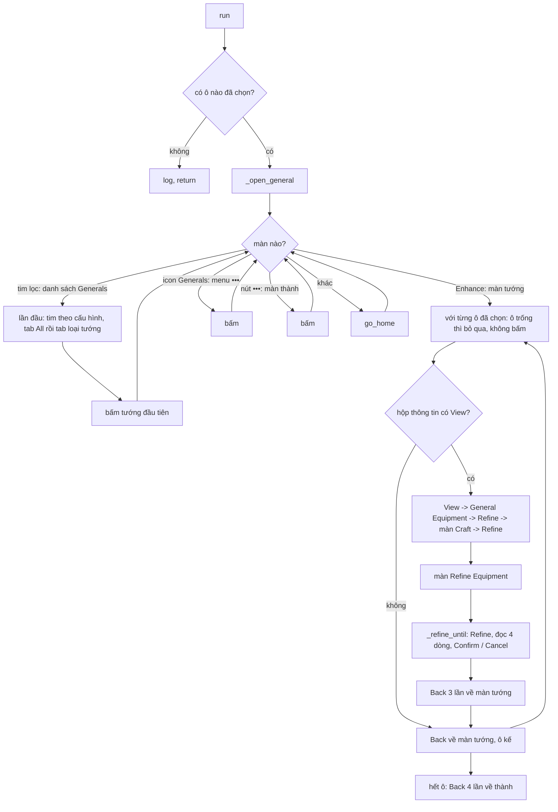

# Refine Equipment (tinh luyện trang bị của tướng)

Tab **Refine Equipment** ([ui/tabs/refine_equipment_tab.py](../../../ui/tabs/refine_equipment_tab.py)). Cột `refine_equipment` của DB:
`{"favorite": false, "general_type": "all", "slots": {"weapon": {"lines": [{"attribute": "Ground Troop Attack", "color": "gold", "lock": true}, ...], "max_refines": 100}, ...}}`.
Mỗi trang bị có ô **Max refines (per equipment)**: 100 .. 1000 hoặc ALL (không giới hạn, tới khi đạt), mặc định 100; hết số lần mà chưa đạt thì Cancel và sang trang bị kế. Mỗi trang bị còn có ô **Stop when** (khi nào dừng + Confirm): 14 mức, xếp mức có vàng trước, từ nhiều xuống ít: 4 Gold, 3 Gold + 1 Orange, 3 Gold, 2 Gold + 2 Orange, 2 Gold + 1 Orange, 2 Gold, 1 Gold + 3 Orange, 1 Gold + 2 Orange, 1 Gold + 1 Orange, 1 Gold, rồi 4 Orange .. 1 Orange; mặc định 1 Gold; đếm số dòng vàng / cam trong 4 dòng New (chỉ tính các dòng thuộc thuộc tính đã chọn). **Thuộc tính cần**: mỗi trang bị có 4 dòng tinh luyện, mỗi dòng ra ngẫu nhiên một trong nhiều thuộc tính, nên tab liệt kê mọi thuộc tính của trang bị thành lưới ô có viền 3 cột để tích nhiều thuộc tính (không giới hạn 4). Không cần đúng vị trí dòng. Mỗi dòng có **màu tối thiểu riêng** (Orange / Gold) và ô **Lock**: đã ra đúng thuộc tính + màu thì khoá dòng lại (ổ khoá cạnh dòng) rồi Refine tiếp các dòng còn lại; không Lock thì chỉ tính là đã đạt.
Khác hẳn nhiệm vụ Refine của King's Path (đó đi qua Lò rèn và chỉ bấm Refine rồi Cancel cho đủ số lần); activity này đi từ **tướng**, tinh luyện
**6 trang bị** của một tướng, mỗi trang bị có 4 dòng, cày tới khi đủ các dòng người dùng chọn.

> Trạng thái (cập nhật): vòng Refine + Lock + Confirm đã chạy trọn trên 21913 (nhẫn, mức dừng 3 Gold: khoá sẵn 2 dòng vàng, 2 lần Refine, Confirm); `READY = True`.
> (Ghi chú cũ bên dưới:) đi tới màn Refine Equipment của cả 6 ô, đọc dòng (tên + màu) và vòng Refine / Confirm / Cancel đã viết; điều hướng đã chạy thật trên 21913, **vòng Refine
> chưa chạy trọn từ đầu tới Confirm trên máy** (mới thử từng phần: bấm Refine + Cancel nhiều lần, đọc 224 dòng thật). Lock đã viết và chạy thật một phần ([TODO.md](TODO.md)).

## Điểm vào

- `run(bot, settings)` ở [run.py](run.py); dòng `refine_equipment` trong [bot/worker/priority.py](../../worker/priority.py): `priority` 666 (sau Craft 669 và
  General Buy 668), `once`. Không cần route công trình. `JOB.enabled`: `READY` và có ít nhất một trang bị đã tích thuộc tính.
- Ô không tích dòng nào thì bỏ qua; cả 6 ô trống thì `run` ghi log rồi return.
- Lỗi thì `@save_errors(KEY)` lưu `refine_equipment_error` vào DB.

## Vòng lặp chính

1. **Tới màn tướng** (`_open_general`, tối đa 15 bước, mỗi bước chụp lại và nhận màn bằng ảnh): thấy nút Enhance = đang ở màn tướng; thấy tim lọc = danh sách
   Generals; thấy icon Generals = menu •••, bấm xong chờ 1 s rồi kiểm tra đã vào danh sách / màn tướng chưa, tối đa 5 lần; thấy nút ••• = màn thành; không nhận ra gì thì `go_home`.
2. **Lọc danh sách** (`_apply_filters`, đúng một lần): tim yêu thích bật / tắt theo `favorite` (nhìn tim hiện tại là `favoriteOn` hay `favoriteOff`). Tab đang chọn
   giãn ra hiện tên (hammer = "Development", crown = "Duty") và đẩy các tab khác đi chỗ khác, nên luôn bấm tab **All** trước (x 10,9 %) rồi mới bấm tab loại
   tướng (x theo `GENERAL_TYPES`, đúng khi All đang chọn). Sau lọc, nếu danh sách trống (giữa màn hiện chữ "No favorite General" khi đã tích tim, hoặc "No General!" khi chưa tích tim; loại tướng nào không có tướng cũng vậy) thì ghi log, Back về thành (tối đa 4 lần, dừng khi thấy nút •••) và **dừng activity**; không thì bấm tướng đầu tiên (22,7 %, 49,7 %), rồi chờ 1 s kiểm tra đã sang màn tướng (thấy Enhance) chưa, tối đa 8 lần.
3. **Sáu ô trang bị** trên màn tướng (`SLOTS`, % màn hình): Weapon (15,9; 24,1), Armor (15,9; 38,4), Boots (15,9; 51,8), Helmet (83,8; 24,1), Pants
   (83,8; 38,4), Ring (83,8; 51,8). Trước khi bấm, kiểm tra ô có đồ không (ô chưa mặc đồ là biểu tượng xám, độ bão hòa trung bình < 100; ô trống thì ghi log và bỏ qua, không bấm). Bấm ô rồi chờ 1 s tìm chữ View, tối đa 8 lần (không thấy thì bấm lại ô một lần nữa, nếu vẫn ở màn tướng) -> hộp thông tin (có Basic / Set / **Refining Attributes** là 4 dòng đang có) -> **View** (vị trí lên xuống theo
   độ dài hộp nên tìm bằng ảnh) -> General Equipment -> **Refine** đáy phải -> màn Craft (tab Refine đã chọn sẵn) -> **Refine** đáy trái -> màn **Refine Equipment**. Ba lần chuyển màn này (View, Refine, Refine ở Craft) cùng một cách: bấm nút, chờ 1 s tìm dấu hiệu của màn kế, tối đa 8 lần; không thấy mà nút còn hiện thì bấm lại một lần (tối đa 2 lần bấm mỗi nút).
4. **Màn Refine Equipment**: khung Original (4 dòng đang có, mỗi dòng ổ khoá + tên + giá trị + khoảng), nút Refine giữa đáy; bấm Refine thì hiện khung New
   (4 dòng mới) kèm Cancel / Confirm. Lần Refine đầu của trang bị chưa từng tinh luyện áp thẳng thành Original, không có New. Ô "Gold / Orange Attribute" và nút
   Advanced Filter của màn là bộ lọc cảnh báo của game, bot không dùng (không tích, không đụng tới).
5. Xong màn: Back 3 lần (Refine Equipment -> Craft -> General Equipment -> màn tướng, kiểm tra thấy Enhance mà không còn View), tới ô kế. Hết ô: Back 4 lần về thành.

## Khi vào màn Refine Equipment (làm trước khi Refine)

1. **Đọc dòng có sẵn** (`_read_lines`): tìm ổ khoá ở cột trái khung Original: vàng (`lockOn`) = đã khoá, xám (`lockOff`) = chưa khoá, ngưỡng 0,9 (đúng 1,00 / sai 0,61 .. 0,63). Khoá + chưa khoá tối đa 4; trang bị chưa tinh luyện không có
   khung Original nên 0 dòng. Ghi log số dòng, số đã khoá. Khoá dòng làm nút Refine tính thêm kim cương.
2. Bot **không** tích ô Gold / Orange Attribute của game nữa (đã bỏ theo yêu cầu); ô đó chỉ là cài đặt cảnh báo của game, không dùng để quyết định dừng.

## Danh mục thuộc tính (nút Advanced Filter, chụp ở 21913)

| Ô | Thuộc tính |
| --- | --- |
| Weapon | Ground / Ranged / Mounted / Siege Machine Attack; Food / Lumber / Stone / Ore Gathering Speed; March Speed; March Speed to Monsters; Increases Troop Capacity in Subordinate City |
| Armor | 4 loại Defense; 4 loại Load; Increases Gold Production Speed / Construction Speed in Subordinate City; Subordinate City Training Speed |
| Boots | 4 loại Defense; 4 loại Load; March Speed; March Speed to Monsters; Increases Troop Capacity in Subordinate City |
| Helmet, Pants | 4 loại HP; 4 loại Gathering Speed; 3 dòng Subordinate City (Gold Production, Construction, Training) |
| Ring | 4 loại Attack; 4 loại Load; 3 dòng Subordinate City |

Danh mục theo vị trí ô (người dùng xác nhận: cùng vị trí ô thì giống nhau, không phụ thuộc loại đồ như giáo / cung / kiếm). Lấy từ trang bị của tướng đầu tiên (Dragon Spear, Courageous Dragon Armor, Fearless Dragon Boots, Fearless King's Helmet, Courageous King's Leg Armor,
Courageous Dragon Ring); chưa kiểm cho loại trang bị khác (cung, giáo... có cùng danh mục không).

## Ảnh đã đo (396x704)

`Images/RefineEquipment/`: `menuGenerals` 1,00 (màn khác <= 0,43), `enhance` 1,00 (hộp thông tin phủ lên 0,99; màn khác <= 0,52), `view` 1,00 (0,92 .. 0,99 giữa các ô;
màn khác <= 0,52), `equipmentRefine` 1,00 (<= 0,53), `confirm` 1,00 (màn Refine Equipment chưa có kết quả 0,75 -> ngưỡng 0,9). Dùng chung ảnh có sẵn: `OpenBox/Setup/chucnang.png`
(nút •••), `JoinBoss/favoriteOn|Off.png` (tim; tim tắt 0,88 -> ngưỡng 0,8), `Event/KingsPath/Refine/{refineButton,equipmentTitle,equipmentRefine,cancel}.png`.

## Test

[tests/refine_equipment/test_flow.py](../../../tests/refine_equipment/test_flow.py): từ màn thành tới màn Refine Equipment của ô vũ khí rồi Back về thành (ảnh thật ở
tests/refine_equipment/screens/, chụp ở 21913); không tích dòng nào thì không làm gì. Chạy thật trên 21913: đi qua cả 6 ô, tim yêu thích, tab loại tướng đều đúng.

## Nhận trạng thái màn Refine

Vừa vào màn Refine Equipment có hai khả năng: thấy nút **Refine** (bình thường) hoặc thấy **Cancel / Confirm** (còn kết quả New treo từ lần trước, vd lần trước dừng vì dòng vàng lạ: kết quả vẫn còn khi quay lại, không có nút Refine). Bot chờ (1 s, tối đa 8 lần) tới khi thấy một trong hai. Có Cancel / Confirm thì xử lý kết quả đó như vừa ra (đọc 4 dòng New: đủ -> Confirm, dòng vàng lạ -> dừng, còn lại -> Cancel) rồi Refine tiếp; không có thì phân loại theo ổ khoá bên dưới.

### Theo ổ khoá (`_lock_counts`, khi có nút Refine)

Bot tìm ổ khoá ở cột trái (x 12 .. 55) theo thứ tự:
1. Có ổ khoá **mở** (xám) -> trang bị đã tinh luyện: làm bình thường (vòng Refine bên dưới).
2. Không có khoá mở: tìm ổ khoá **đóng** (vàng). Cả 4 dòng đều khoá -> không Refine được nữa (nút Refine chuyển xám), ghi log và **bỏ qua sang trang bị khác**. Giữa vòng Refine cũng vậy: sau khi bot khoá dòng (đầu vòng hoặc sau mỗi lần Confirm giữ kết quả) mà cả 4 dòng đã khoá thì bỏ qua trang bị như bình thường.
3. Không thấy ổ khoá nào -> **chưa tinh luyện** (những khoảng đen lớn, chưa có khung Original): không đọc dòng, không khoá, chỉ việc **bấm Refine rồi chờ bước kế tiếp** (thấy khung Original hiện ra là xong lần đầu, khỏi chờ Confirm).

## Về thành trước khi làm (`_at_city`)

Đầu activity (chỉ một lần) bot về thành: ở bản đồ thế giới thì bấm nút về thành; màn khác trong game (màn Refine, màn tướng, danh sách...) thì Back tới khi thấy nút ••• (tối đa 6 lần: từ màn Refine tới thành cần 5), hộp "thoát game" thì Cancel, màn thành đã sạch thì không Back. Không về được thì không tinh luyện. Giữa các trang bị bot chỉ Back về **màn tướng** (không về thành).

## Dòng vàng không nhận ra tên

Trong vòng Refine, nếu một dòng **vàng** mà không nhận ra là dòng nào (khung Original lúc đầu hoặc kết quả New), bot **dừng trang bị đó và chuyển sang trang bị khác**, không bấm Cancel / Confirm, rời màn bằng Back (Back ra thẳng màn tướng không hỏi gì; theo người dùng, khi quay lại trang bị đó kết quả New cũ vẫn còn, Cancel / Confirm hiện sẵn nên có thể xem lại dòng vàng đó; lần sau bot vào trang bị có kết quả treo thì đọc và xử lý như một kết quả vừa ra: nếu vẫn có dòng vàng lạ thì dừng lại như cũ). Dòng màu khác (trắng / tím / cam) không nhận ra tên thì vẫn Cancel và tinh luyện bình thường.

## Vòng Refine (`_refine_until`)

Luật dừng: chỉ có hai cách dừng, **hết số lần Refine** (`max_refines`) hoặc **đủ số dòng yêu cầu** (`stop`). Chỉ tính các dòng đúng thuộc tính đã tích, có màu từ mức tối
thiểu của thuộc tính đó trở lên VÀ đúng loại tăng đã chọn (ô All / % / Flat của từng thuộc tính: tăng % như "+3.9%" hay tăng chỉ số như "+128"; All = cả hai). Đủ khi có ít nhất `gold` dòng vàng và ít nhất `gold + orange` dòng cam trở lên (vàng cũng tính là cam). VD chỉ tích Ground Troop Load, `stop` = 3 Orange:
cả 3 dòng phải là Ground Troop Load màu cam trở lên (2 cam + 1 vàng vẫn đạt, dòng thuộc thuộc tính khác không tính).

1. Đọc khung **Original** (bot/ocr/read_refine_lines.py): đã đủ thì ghi log và không Refine.
2. Chờ nút Refine giữa đáy (thấy ngay thì bấm, không thì chờ 1 s, tối đa 10 lần), bấm, rồi chờ 1 s chụp lại, tối đa 10 lần (hết mà chưa thấy Confirm thì bấm Refine lại): hộp cảnh báo "unlocked high quality attribute(s)" thì tích "Don't show this again for today" rồi Confirm
   (Refine tiếp); thấy nút **Confirm** = có kết quả New.
3. Không có Confirm (lần đầu của trang bị chưa tinh luyện: dòng áp thẳng thành Original; màn chưa tinh luyện không có khung Original, chỉ có những khoảng đen lớn, nên thấy khung Original hiện ra là biết đã áp, khỏi chờ 10 s): đọc Original, đủ thì dừng, chưa thì Refine tiếp.
4. Có Confirm: đọc 4 dòng **New** (tên + màu + loại), lặp cách 1 s tới khi hai lần đọc liên tiếp giống nhau (tối đa 5 lần chờ thêm; màn còn chuyển động thì đọc lệch, nên không ổn định thì coi như chưa đạt). Đủ -> bấm **Confirm**, dừng. Có thêm dòng yêu cầu bật Lock mà chưa khoá -> **Confirm** giữ kết quả rồi bấm ổ khoá dòng đó, Refine tiếp (dòng đã khoá giữ nguyên ở lần Refine sau). Còn lại -> bấm **Cancel** (giữ dòng cũ), Refine tiếp. Sau Cancel / Confirm chờ nút Refine 1 s, tối đa 10 lần. Hộp thoại lạ chặn màn (không phải hai hộp đã biết): màn đứng yên (hai lần chụp liên tiếp giống nhau) mà không thấy nút Refine, kiểm tra tối đa 2 lần rồi bấm **Back một lần** (chỉ một lần mỗi lần chờ, để Back không đẩy bot ra khỏi màn Refine); màn đang chuyển cảnh thì hình đổi giữa hai lần chụp nên không bị Back nhầm.
5. Hết `max_refines` mà chưa đủ: ghi log, sang trang bị kế (dòng cũ vẫn giữ vì mọi kết quả chưa đạt đều bị Cancel).

**Đọc dòng**: định vị theo tiêu đề khung (headerNew / headerOriginal), 4 hàng cách nhau 39 px. Tên: so mặt nạ chữ với mẫu Arial 13 px render sẵn (Images/RefineEquipment/Names/, sinh bằng
`python -m bot.ocr.make_refine_name_samples`), CHỈ trong danh mục của trang bị đang làm (nhẫn 11 tên: 224 dòng ở 21913 đều nhận tên, hơn tên thứ hai >= 0,11). Loại tăng: có ký tự "%" ở cuối cột giá trị (mẫu percent.png; dòng % khớp >= 0,85, dòng chỉ số <= 0,45 trên 224 dòng) thì là %, không thì Flat; đo ở nhẫn: Ground / Ranged / Mounted / Siege Attack ra cả hai loại, Load và dòng Subordinate City luôn là %.
Màu: theo hue + độ bão hòa của chữ
(thường S 60-100, tím H ~144, cam H 11-12, vàng H 24; xem bộ nhớ dự án và Images/RefineEquipment/LineColors/).

Thử dùng bộ lọc Advanced Filter của game (báo khi kết quả có thuộc tính đã chọn) rồi bỏ: bộ lọc chỉ cho chọn một loại mà ta cần chọn nhiều.

## Khoá dòng (Lock)

Thuộc tính nào bật **Lock** thì dòng thuộc yêu cầu (đúng thuộc tính, màu từ mức tối thiểu, đúng loại tăng) được khoá lại để Refine sau không đổi nó:
- **Ổ khoá**: mỗi dòng khung Original có ổ khoá bên trái (x 32): vàng = đã khoá, xám = chưa khoá (bot/ocr/read_refine_lines.py `lock_state`, ngưỡng 0,8; đã khoá 0,92 .. 0,94, chưa khoá 0,85 .. 1,00, trạng thái kia <= 0,63).
  Vị trí y của dòng tính theo tiêu đề khung Original vì khung dịch lên xuống tuỳ màn (tiêu đề ở y 246 / 303 / 368). Khung đã cuộn (có Cancel / Confirm) không có ổ khoá.
- **Khi nào khoá** (`_lock_lines`): đầu vòng Refine, rồi sau mỗi lần Confirm giữ kết quả. Bấm ổ khoá từng dòng cần khoá và chưa khoá (chờ 1 s mỗi lần), rồi đọc lại (chờ 1 s, tối đa 5 lần, tới khi các dòng vừa bấm hiện đã khoá).
- **Nút Refine khi có dòng khoá**: nút hiện thêm dòng giá kim cương nên ảnh nút cũ không khớp; bot tìm chữ "Refine" (refineWord.png, ngưỡng 0,7, vùng đáy màn) thay cho cả nút.
- **Dòng đã khoá giữ nguyên** ở lần Refine sau (đo 21913: dòng khoá y hệt ở Original và New), nên khi New có THÊM dòng yêu cầu bật Lock so với số đã khoá thì bot **Confirm** giữ kết quả rồi khoá dòng mới
  (Cancel sẽ mất dòng tốt vừa ra). Đủ mức dừng thì Confirm và dừng như thường.
- **Chi phí**: khoá dòng làm nút Refine tính thêm kim cương (hiện "1.5K -> 0" trên nút).
- Chạy thật 21913 (nhẫn): khoá dòng Siege Machine Load vàng, 0 dòng khác bị khoá, bot dừng vì đã đủ 1 Gold.
