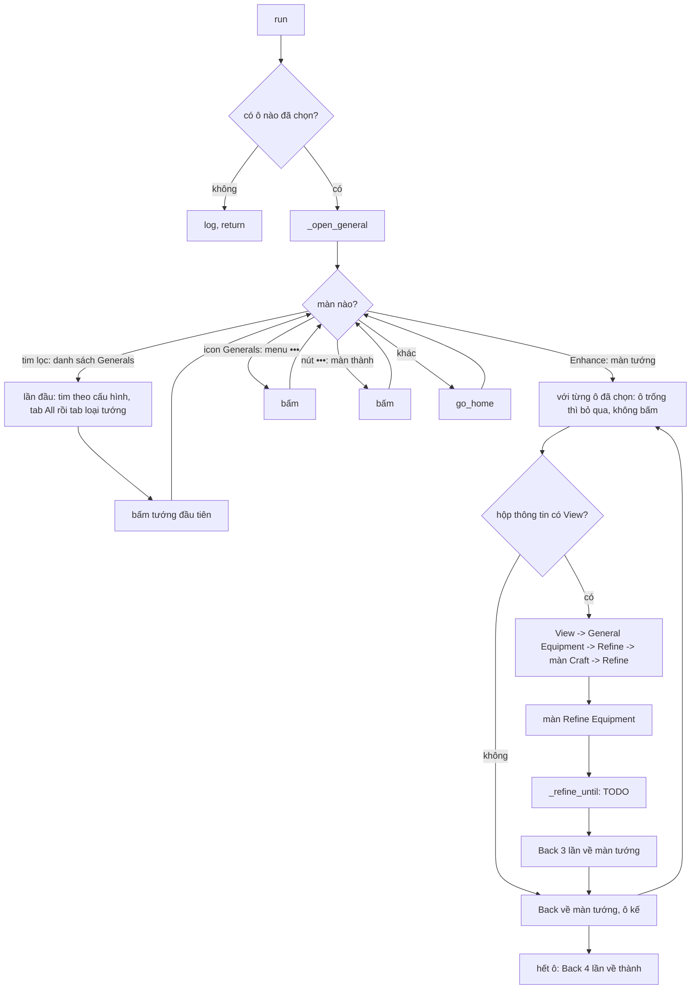

# Refine Equipment (tinh luyện trang bị của tướng)

Tab **Refine Equipment** ([ui/tabs/refine_equipment_tab.py](../../../ui/tabs/refine_equipment_tab.py)). Cột `refine_equipment` của DB:
`{"favorite": false, "general_type": "all", "slots": {"weapon": {"lines": [{"attribute": "Ground Troop Attack", "color": "gold", "lock": true}, ...], "max_refines": 100}, ...}}`.
Mỗi trang bị có ô **Max refines (per equipment)**: 100 .. 1000 hoặc ALL (không giới hạn, tới khi đạt), mặc định 100; hết số lần mà chưa đạt thì Cancel và sang trang bị kế. **Dòng cần có**: mỗi trang bị có 4 dòng tinh luyện nên tab cho thêm tối đa 4 dòng cần có bằng nút **+ Add line** (xoá bằng nút thùng rác). Mỗi dòng chọn một thuộc tính trong danh mục của trang bị, hai dòng có thể trùng thuộc tính. Không cần đúng vị trí dòng; dòng không thêm thì tuỳ ý. Mỗi dòng có **màu tối thiểu riêng** (Orange / Gold) và ô **Lock**: đã ra đúng thuộc tính + màu thì khoá dòng lại (ổ khoá cạnh dòng) rồi Refine tiếp các dòng còn lại; không Lock thì chỉ tính là đã đạt.
Khác hẳn nhiệm vụ Refine của King's Path (đó đi qua Lò rèn và chỉ bấm Refine rồi Cancel cho đủ số lần); activity này đi từ **tướng**, tinh luyện
**6 trang bị** của một tướng, mỗi trang bị có 4 dòng, cày tới khi đủ các dòng người dùng chọn.

> Trạng thái: **đi tới màn Refine Equipment của cả 6 ô đã chạy thật (21913)**; đọc 4 dòng New và quyết định Confirm / Cancel còn TODO
> ([TODO.md](TODO.md)), nên `READY = False`: bot mở màn rồi Back, chưa bấm Refine.

## Điểm vào

- `run(bot, settings)` ở [run.py](run.py); dòng `refine_equipment` trong [bot/worker/priority.py](../../worker/priority.py): `priority` 666 (sau Craft 669 và
  General Buy 668), `once`. Không cần route công trình. `JOB.enabled`: `READY` và có ít nhất một trang bị đã tích thuộc tính.
- Ô không tích dòng nào thì bỏ qua; cả 6 ô trống thì `run` ghi log rồi return.
- Lỗi thì `@save_errors(KEY)` lưu `refine_equipment_error` vào DB.

## Vòng lặp chính

1. **Tới màn tướng** (`_open_general`, tối đa 15 bước, mỗi bước chụp lại và nhận màn bằng ảnh): thấy nút Enhance = đang ở màn tướng; thấy tim lọc = danh sách
   Generals; thấy icon Generals = menu •••, bấm xong chờ 1 s rồi kiểm tra đã vào danh sách / màn tướng chưa, tối đa 5 lần; thấy nút ••• = màn thành; không nhận ra gì thì `go_home`.
2. **Lọc danh sách** (`_apply_filters`, đúng một lần): tim yêu thích bật / tắt theo `favorite` (nhìn tim hiện tại là `favoriteOn` hay `favoriteOff`). Tab đang chọn
   giãn ra hiện tên (hammer = "Development", crown = "Duty") và đẩy các tab khác đi chỗ khác, nên luôn bấm tab **All** trước (x 10,9 %) rồi mới bấm tab loại
   tướng (x theo `GENERAL_TYPES`, đúng khi All đang chọn). Sau lọc luôn bấm tướng đầu tiên (22,7 %, 49,7 %), rồi chờ 1 s kiểm tra đã sang màn tướng (thấy Enhance) chưa, tối đa 8 lần.
3. **Sáu ô trang bị** trên màn tướng (`SLOTS`, % màn hình): Weapon (15,9; 24,1), Armor (15,9; 38,4), Boots (15,9; 51,8), Helmet (83,8; 24,1), Pants
   (83,8; 38,4), Ring (83,8; 51,8). Trước khi bấm, kiểm tra ô có đồ không (ô chưa mặc đồ là biểu tượng xám, độ bão hòa trung bình < 100; ô trống thì ghi log và bỏ qua, không bấm). Bấm ô rồi chờ 1 s tìm chữ View, tối đa 8 lần (không thấy thì bấm lại ô một lần nữa, nếu vẫn ở màn tướng) -> hộp thông tin (có Basic / Set / **Refining Attributes** là 4 dòng đang có) -> **View** (vị trí lên xuống theo
   độ dài hộp nên tìm bằng ảnh) -> General Equipment -> **Refine** đáy phải -> màn Craft (tab Refine đã chọn sẵn) -> **Refine** đáy trái -> màn **Refine Equipment**. Ba lần chuyển màn này (View, Refine, Refine ở Craft) cùng một cách: bấm nút, chờ 1 s tìm dấu hiệu của màn kế, tối đa 8 lần; không thấy mà nút còn hiện thì bấm lại một lần (tối đa 2 lần bấm mỗi nút).
4. **Màn Refine Equipment**: khung Original (4 dòng đang có, mỗi dòng ổ khoá + tên + giá trị + khoảng), nút Refine giữa đáy; bấm Refine thì hiện khung New
   (4 dòng mới) kèm Cancel / Confirm. Lần Refine đầu của trang bị chưa từng tinh luyện áp thẳng thành Original, không có New. Ô "Gold / Orange Attribute" và nút
   Advanced Filter của màn là bộ lọc cảnh báo của game, bot không dùng.
5. Xong màn: Back 3 lần (Refine Equipment -> Craft -> General Equipment -> màn tướng, kiểm tra thấy Enhance mà không còn View), tới ô kế. Hết ô: Back 4 lần về thành.

## Khi vào màn Refine Equipment (làm trước khi Refine)

1. **Đọc dòng có sẵn** (`_read_lines`): tìm ổ khoá ở cột trái khung Original: vàng (`lockOn`) = đã khoá, xám (`lockOff`) = chưa khoá, ngưỡng 0,9 (đúng 1,00 / sai 0,61 .. 0,63). Khoá + chưa khoá tối đa 4; trang bị chưa tinh luyện không có
   khung Original nên 0 dòng. Ghi log số dòng, số đã khoá. Khoá dòng làm nút Refine tính thêm kim cương.
2. **Tích ô cảnh báo** (`_tick_attribute_box`): mọi dòng người dùng chọn đều màu **vàng** thì tích **Gold Attribute**, ngược lại tích **Orange Attribute**; ô còn lại bỏ tích. Tích ô cần trước (chữ + so ảnh boxOn / boxOff), chụp lại rồi mới bỏ tích ô kia nếu còn tích: đo trên 21913, game tự bỏ tích ô kia khi tích một ô, nên bấm cả hai theo một ảnh chụp sẽ tích lại ô vừa bị bỏ. Mỗi lần bấm chờ 1 s.

## Danh mục thuộc tính (nút Advanced Filter, chụp ở 21913)

| Ô | Thuộc tính |
| --- | --- |
| Weapon | Ground / Ranged / Mounted / Siege Machine Attack; Food / Lumber / Stone / Ore Gathering Speed; March Speed; March Speed to Monsters; Increases Troop Capacity in Subordinate City |
| Armor | 4 loại Defense; 4 loại Load; Increases Gold Production Speed / Construction Speed in Subordinate City; Subordinate City Training Speed |
| Boots | 4 loại Defense; 4 loại Load; March Speed; March Speed to Monsters; Increases Troop Capacity in Subordinate City |
| Helmet, Pants | 4 loại HP; 4 loại Gathering Speed; 3 dòng Subordinate City (Gold Production, Construction, Training) |
| Ring | 4 loại Attack; 4 loại Load; 3 dòng Subordinate City |

Danh mục lấy từ trang bị của tướng đầu tiên (Dragon Spear, Courageous Dragon Armor, Fearless Dragon Boots, Fearless King's Helmet, Courageous King's Leg Armor,
Courageous Dragon Ring); chưa kiểm cho loại trang bị khác (cung, giáo... có cùng danh mục không).

## Ảnh đã đo (396x704)

`Images/RefineEquipment/`: `menuGenerals` 1,00 (màn khác <= 0,43), `enhance` 1,00 (hộp thông tin phủ lên 0,99; màn khác <= 0,52), `view` 1,00 (0,92 .. 0,99 giữa các ô;
màn khác <= 0,52), `equipmentRefine` 1,00 (<= 0,53), `confirm` 1,00 (màn Refine Equipment chưa có kết quả 0,75 -> ngưỡng 0,9). Dùng chung ảnh có sẵn: `OpenBox/Setup/chucnang.png`
(nút •••), `JoinBoss/favoriteOn|Off.png` (tim; tim tắt 0,88 -> ngưỡng 0,8), `Event/KingsPath/Refine/{refineButton,equipmentTitle,equipmentRefine,cancel}.png`.

## Test

[tests/refine_equipment/test_flow.py](../../../tests/refine_equipment/test_flow.py): từ màn thành tới màn Refine Equipment của ô vũ khí rồi Back về thành (ảnh thật ở
tests/refine_equipment/screens/, chụp ở 21913); không tích dòng nào thì không làm gì. Chạy thật trên 21913: đi qua cả 6 ô, tim yêu thích, tab loại tướng đều đúng.
